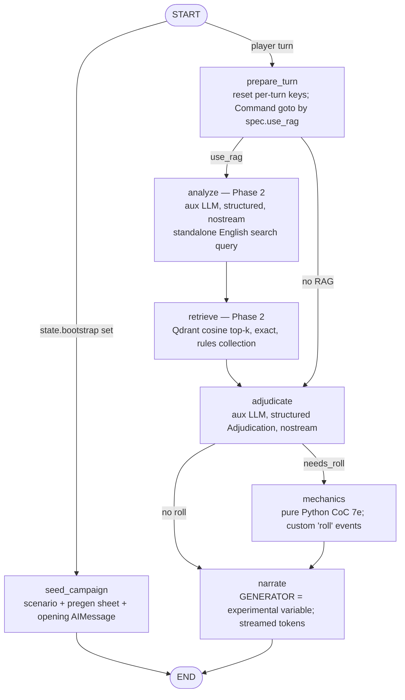

# gm-assistant: final architecture and plan (judge's decision)

Date: 2026-09-13. Repo HEAD: `2799aaf`. Nothing in the repo was changed.

**Inputs:**
- `tezy.txt`: the thesis abstract. It describes a CoC Keeper agent built from RAG plus LoRA, where RAG takes priority over what the model already knows, and the method must carry over to other TTRPGs.
- `issues.md`: 83 verified issues. They are numbered **#1–#83** here in file order (index in §4.0).
- `research.md`
- `design-A-fastapi-langgraph.md` (A)
- `design-B-django-langgraph.md` (B)
- The ~30 source files in the repo.

API claims that the proposals depend on were re-checked against the LangChain/LangGraph doc snapshots in `scratchpad/docs/` and on the web: FastAPI SSE docs, the `langchain-ollama` source, the `qdrant-client` source, and the `django-tasks-db` PyPI page.

---

## 0. TL;DR

- **Winner: Design A (FastAPI + LangGraph).** It stays in its own repo layout, but its MVP scope is cut to about a third. A few ideas are grafted in from B.
- **Stack:**
  - FastAPI 0.141 with native `fastapi.sse`.
  - LangGraph 1.2 `StateGraph`, used as a library.
  - LangChain used only for components: chat models, embeddings, text splitters and messages.
  - `AsyncSqliteSaver` in the MVP. Postgres is an optional swap later.
  - Qdrant + `nomic-embed-text` via Ollama for RAG.
  - Gemini as the reference model. Gemma 4 E4B base vs LoRA on vLLM for the thesis numbers.
- **Not in the MVP:** Django, SQLAlchemy/Alembic, Postgres, nginx, admin endpoints, the Agent Server, `create_agent` ReAct loops, LLM tool-calling for dice, interrupts, leak scanners, summarisation.
- **The MVP takes 10 working days.** It is a persistent, streaming Call of Cthulhu Keeper with deterministic 7e dice, server-owned history and a reproducible experiment spec on every campaign. Its graph already has the variant switch, so RAG, FT and eval plug into the same pipeline later.
- **Research phases after the MVP:**
  - Phase 2: RAG ingestion and retrieval (weeks 3–4).
  - Phase 3: eval harness and the first prompt-only vs RAG results (weeks 5–6).
  - Phase 4: LoRA fine-tuning (weeks 7–9).
  - Phase 5: full 2×2 matrix, ablations, write-up (weeks 10–11).
- **A bug found in the research and in A:**
  - The `OllamaEmbeddings` prefix subclass (research §2.2/§5, A §4.2) double-prefixes queries: `"search_document: search_query: …"`.
  - Cause: `OllamaEmbeddings.embed_query` calls `self.embed_documents([text])[0]`, and `aembed_query` calls `self.aembed_documents` (checked in the langchain-ollama source).
  - Fix: wrap the embeddings object instead of subclassing it (§6.5).

---

## 1. Scores

Scale 1–10, higher is better. "Simplicity" means simplicity for one master's student, not architectural elegance.

| Criterion | A: FastAPI + LangGraph | B: Django + LangGraph | Notes |
|---|:-:|:-:|---|
| Thesis alignment | **9** | 8 | Both enforce RAG priority structurally: a mandatory retrieve node, the prompt contract, and citation checks. A adds conflict probes with a context-adherence metric, error attribution (retrieval vs generation), and a `mechanics_engine` factor. B holds the aux adjudicator fixed so the generator is the only variable, and uses separate public and keeper collections. B's FT arm cannot affect adjudication at all; that is defensible but not discussed. |
| Simplicity for one student | 4 | 3 | **A:** 9 graph nodes; Postgres + SQLAlchemy + Alembic; nginx; admin ingest/eval API; turn-admission table with a partial unique index; reaper; fork-by-checkpoint retry; interrupt; leak scan; about 70 files. **B:** everything A has, plus Django + Ninja + CSRF sessions, a custom ASGI lifespan wrapper, a `django-tasks-db` worker, two databases, `sync_to_async` boundaries, 6 Django apps and a repository protocol. |
| Correctness of library usage | **8** | 7 | Neither invents APIs; both mostly match research.md. **A:** the embeddings prefix bug; `.bind(seed=…)` instead of the constructor field; `Page[T]` PEP 695 generic model (unnecessary, unverified); `search_params` passthrough in langchain-qdrant (unverified, flagged by A). **B:** garbled code in §3.2 (`def launch(self, turn, campaign```python`); `RetryPolicy` on the streamed `narrate` node duplicates tokens; `@lru_cache` on an instance method; `db_worker` queue flag unverified. Details in §1.1. |
| Streaming and persistence quality | **9** | 8 | **A:** `fastapi.sse` (15 s ping, no-buffer headers), checkpointer opened in lifespan, v2 `StreamPart` adapter with a node whitelist, idempotency, cancellation semantics, a read model. **B:** the graph run is decoupled from the HTTP connection, which is robust to disconnects. But SSE is hand-rolled, it is single-worker only, the checkpoint and Django projections can drift, and retry-duplicated tokens need client resets. |
| Experiment reproducibility | 9 | 8 | **A:** frozen `RunContext` per campaign; `arm_hash`; prompt template hashes; `corpus_version`; `exact=True` retrieval; seeds; YAML matrices; per-item JSONL. **B:** `ExperimentSpec.config_hash`; immutable `ExperimentConfig`; human-rating and gold-labelling workflows in admin. Those workflows are useful but cost a lot of Django. |
| Time to MVP | 5 | 4 | A claims an MVP at the end of week 2, but its Phase 1 alone (auth, admission, reaper, Alembic, CI, Postgres) is 2–3 weeks for one person. B's Phase 1 is only the platform, with the Keeper arriving in Phase 2; realistically 4+ weeks. FT arrives in week 6–7 (A) or week 9–11 (B). |
| **Total (of 60)** | **44** | **38** | |

### 1.1 Library-usage audit

"Verified" means checked in `scratchpad/docs/` (LangChain/LangGraph doc snapshots), research.md [high] facts, or a web or source check made for this review.

| # | Where | Claim or code | Verdict | Correction used in this document |
|---|---|---|---|---|
| L1 | Research §2.2/§5, A §4.2 | `class NomicEmbeddings(OllamaEmbeddings)` overrides `embed_documents` and `embed_query` to add prefixes | **Bug.** `embed_query` → `self.embed_documents([text])[0]`, so queries become `search_document: search_query: q` (langchain-ollama source). | Compose instead: a wrapper `Embeddings` that calls the inner `aembed_documents` with the right prefix (§6.5). |
| L2 | A §2.5 | `m.bind(seed=seed)` "all three chat classes accept a seed parameter" | Doubtful for `ChatGoogleGenerativeAI` (seed is a model **field**, and call-time passthrough is not documented). | Pass `seed=` to the constructor and cache one model per `(profile, seed)` (§6.6). |
| L3 | A §3.4 | Retry = run again with `configurable.checkpoint_id = parent` (fork) | Valid (time-travel replay), but more machinery than needed. | Use the documented fault-tolerance path: `astream(None, config)` resumes the failed superstep. Nodes that already finished (e.g. `mechanics`, so the dice) are not re-run (checkpointers doc, "Pending writes"). |
| L4 | A §3.3 | `class Page[T](BaseModel)` (PEP 695) | Unverified with Pydantic 2.13 and unnecessary. | Plain `{"items": [...]}` responses. |
| L5 | A §4.4, Appx B3 | `search_params=SearchParams(exact=True)` forwarded by `QdrantVectorStore.similarity_search_with_score` | Unverified. | Retrieve with `AsyncQdrantClient.query_points(collection_name, query, query_filter, search_params, limit, with_payload)` (qdrant-client source, verified). The payload layout stays compatible with langchain-qdrant. |
| L6 | B §2.6 | `RetryPolicy` + `timeout` on `narrate` / `answer_rules` (streamed) | Legal, but a retry re-streams tokens and the client must reset the bubble. | No `RetryPolicy` on the streamed node; model-level `max_retries` covers connection errors before the first token; user-driven retry resumes. |
| L7 | B §3.2 | Code block corrupted (`def launch(self, turn, campaign```python`) | Document defect. | n/a |
| L8 | B §6.1 | `@lru_cache` on `ModelRegistry._build(self, …)` | Works, but keeps `self` alive and needs hashable args. | Explicit dict cache (§6.6). |
| L9 | B §3.1 | Custom ASGI lifespan wrapper around Django | Spec-compliant; research confirms Django's `ASGIHandler` rejects lifespan. Fragile (breaks under `runserver`/WSGI). | Not needed with FastAPI. |
| L10 | B §5.1, Appx A | `django-tasks-db==0.13.0`, `django_tasks_db.DatabaseBackend`, `db_worker` | Package exists and supports Django 6.0 (PyPI, verified). Queue-selection flag unverified. | Not used. |
| L11 | Both | `fastapi.sse.EventSourceResponse` / `ServerSentEvent(data=…, event=…)`, POST supported, 15 s ping, `X-Accel-Buffering: no`, FastAPI ≥ 0.135 | **Verified** (FastAPI tutorial page). `data` is JSON-encoded; `raw_data` is sent verbatim. | Used. |
| L12 | Both | `graph.astream(..., stream_mode=[...], version="v2")` → `{"type","ns","data"}`; `messages` data is `(chunk, metadata)` with `langgraph_node` | **Verified** (LangGraph streaming doc, 1.1+). | Used. |
| L13 | Both | `add_node(..., timeout=seconds)` async-only (sync node + timeout fails at compile), `NodeTimeoutError(TimeoutError)`, `RetryPolicy(max_attempts=…, retry_on=…)` | **Verified** (use-graph-api doc, langgraph ≥ 1.2). | Used; every timed node is `async`. |
| L14 | Both | `Runtime[Ctx]` exposes `.context`, `.store`, `.stream_writer`; `StateGraph(State, context_schema=Ctx)`; `ainvoke/astream(..., context=…)` | **Verified** (graph-api doc; research). | Used. |
| L15 | Both | `ChatGoogleGenerativeAI(model, temperature, max_tokens, timeout, max_retries, thinking_level)`; Gemini 3+ auto-sets temperature 1.0 when unset; `response_metadata["finish_reason"]` | **Verified** (integration doc). `thinking_level` levels are per model: check `model.profile`. | Used. Note that thinking tokens count against output, so keep `max_tokens` ≥ 1024 on narration. |
| L16 | Both | `ChatOllama(reasoning=…, seed, num_ctx, num_predict, validate_model_on_init, client_kwargs)` | **Verified** (API reference). | Used. |
| L17 | A §3.4, B §3.2 | `UsageMetadataCallbackHandler` from `langchain_core.callbacks` | Consistent with research; widely used. | Used for per-turn token logs. |
| L18 | Research §6 | `g.add_conditional_edges(START, lambda s, runtime: …)` | Not verified that routers receive `runtime`. | Routers read only state. Variant-dependent routing uses a node returning `Command(goto=…)`, which gets `runtime`. |

---

## 2. Decision

### 2.1 Django vs FastAPI → **FastAPI**

1. **The app has no relational domain for the MVP.** Conversation, game state and the roll log live in LangGraph checkpoints. Django's ORM, admin and auth would only shadow them, which is B's "two stores drifting" risk.
2. **Lifespan and SSE are first-class.** The checkpointer, Qdrant client and model clients open once in `lifespan`. Streaming uses `fastapi.sse`. Django has no lifespan (verified in research), and its SSE is manual.
3. **Async end to end.** The graph, checkpointer, Qdrant client and model clients are all async. Django's partial async (`SynchronousOnlyOperation`, no async transactions) adds friction for no gain.
4. **B's strongest argument, admin for data curation, is cheaper without Django.** Gold sets and SFT review at thesis scale (about 100–1,000 rows) fit JSONL plus a 60-line review CLI or a spreadsheet export. That is not worth a second framework.
5. **Research recommends it.** Research §6 recommends FastAPI + LangGraph-as-library, and the author already leans that way.

### 2.2 LangGraph vs LangChain → **LangGraph `StateGraph` (explicit), LangChain for components only**

- **A fixed pipeline makes the thesis claim testable.** In RAG variants `retrieve` always runs, so no ReAct agent can skip retrieval and answer from memory. The four variants (prompt / RAG / FT / RAG+FT) are **one graph** switched by an immutable `ExperimentSpec` in `context`.
- **`create_agent` (LangChain v1) is not used.** Its model/tool loop hides control flow. Small LoRA models also often break tool-call formats (vLLM docs warn about this), and a variant that can't call tools would confound the FT comparison.
- **Dice are deterministic Python.** They run in a graph node from a structured adjudication, not as an LLM tool call. A `@tool` wrapper is provided only for an optional Gemini "agentic" demo mode (§6.4).
- **LangGraph Agent Server (`langgraph dev`) is for Studio visualisation in development only.** It uses the Elastic-2.0 license and needs Redis/Postgres for self-hosting.

### 2.3 What is kept, grafted, and cut

| From A (kept) | From B (grafted) | Cut or deferred (from either) |
|---|---|---|
| FastAPI lifespan + `fastapi.sse`; v2 StreamPart → SSE adapter with a node whitelist | Aux adjudicator **held fixed across variants** (spec flag `adjudicator: aux\|generator` makes FT-adjudication an ablation) | Postgres, SQLAlchemy, Alembic (MVP) → SQLite checkpointer + a tiny `aiosqlite` campaigns table |
| Frozen per-campaign spec + `spec_hash`; prompt template hashes; seeds; `exact=True` retrieval | Retry = **resume from last checkpoint with `None` input** (not fork) | nginx, prod compose, token auth beyond one optional static token |
| `EmptyGeneration` guard (never persist an empty Keeper turn) | Hypothesis property tests for dice invariants | Admin ingest/eval HTTP endpoints → CLIs |
| `[R#]` chunk markers + citation validation; conflict probes; error attribution | **Separate Qdrant collections** for public rules and Keeper-only scenario text (Phase 3b) | Turn-admission table, partial unique index, heartbeat reaper → per-campaign `asyncio.Lock` (single worker) |
| Vite proxy, so there is no CORS; anchored `.gitignore`; uv lockfile; `python:3.12-slim` | Clue text resolved **by id from data, never from LLM text** (Phase 3b) | `interrupt()` push confirmation, `decide`→`public_brief`, leak scanner, summariser (Phase 3b or later) |
| vLLM: base and LoRA adapter on one server at the same precision | `forced_kind` for eval datasets (skip classification) | B's decoupled background run task (upgrade path if disconnect-robustness matters) |
| Deterministic RNG seeded by a string (`random.Random("seed:turn:i")`) | Player text wrapped as `<player_turn>` data for the adjudicator (CoC-Seduce defence) | LangSmith/Langfuse wiring (env-only, optional); DeltaChannel; v3 event streaming (beta) |

---

## 3. Final architecture

### 3.1 Principles

1. **Code decides outcomes; the LLM decides what to roll and how to tell it.** Success levels, bonus and penalty dice, SAN loss and push legality are pure Python. Skill values come from the server-owned sheet and are never taken from LLM arguments.
2. **One graph, and the variant is data.** `ExperimentSpec` (generator profile, `use_rag`, retrieval params, prompt version, seed) is frozen per campaign or eval item and hashed. Only the RAG block in the prompt and the generator model differ between variants.
3. **RAG priority is structural, stated, checked and measured.**
   - *Structural:* retrieval is mandatory in RAG variants.
   - *Stated:* the prompt contract says "RULES CONTEXT wins on conflict; cite [R#]; otherwise say *Keeper ruling*".
   - *Checked:* cited markers are validated against the ids actually retrieved.
   - *Measured:* conflict probes report a context-adherence rate.
4. **The server owns the conversation.** The client sends only `{client_turn_id, text}`, so forged Keeper turns are impossible.
5. **Generalises to other TTRPGs.**
   - Game-specific parts are the scenario packs, the corpus collection, the `keeper/game/<system>` rules module, the prompt templates, and the LoRA adapter.
   - `game_system` is a payload field and a spec field.
   - The graph, API and eval harness are system-agnostic.

### 3.2 Repo layout

```
gm-assistant/
├── .gitignore                 # anchored (/lib/ not lib/), node_modules/, .env*, /data/private/, /artifacts/, /adapters/, /models/, *.gguf, *.safetensors
├── .gitattributes             # * text=auto eol=lf
├── LICENSE                    # MIT/Apache-2.0 for code only; corpus NOT covered
├── README.md                  # truthful: features, setup, thesis scope, corpus licensing
├── .env.example               # every variable, commented
├── compose.yaml               # api + web (MVP); profiles: rag (qdrant, ollama), vllm
├── data/
│   ├── README.md              # what to download (Chaosium QSR link etc.), licence rules
│   ├── scenarios/demo-haunt/  # COMMITTED self-written scenario pack: scenario.yaml, opening.uk.md, opening.en.md, pregens.yaml
│   ├── open/                  # COMMITTED open corpus: BRP ORC doc (attribution), public-domain Lovecraft (Markdown)
│   └── private/               # GIT-IGNORED: QSR/KRB Markdown, gold sets & SFT data derived from them
├── artifacts/                 # GIT-IGNORED: runs/*.jsonl, eval outputs, chunk dumps
├── src/backend/
│   ├── pyproject.toml  uv.lock  Dockerfile  .dockerignore  langgraph.json (dev: Studio)
│   ├── config/models.yaml     # model profiles (no secrets)
│   ├── experiments/           # play.yaml (default arm for the app), thesis-2x2-gemma4.yaml, ablation-*.yaml
│   ├── server/                # FastAPI layer — thin, no game logic
│   │   ├── main.py            # app + lifespan (checkpointer, store, deps, compiled graph)
│   │   ├── settings.py        # pydantic-settings; fail fast
│   │   ├── routes.py          # campaigns, messages, turns (SSE), retry, health, meta
│   │   ├── store.py           # aiosqlite "campaigns" table (id, title, scenario, language, spec_json, spec_hash)
│   │   └── errors.py          # exception → {code, retryable, message}; never str(exc)
│   ├── keeper/                # NO FastAPI imports; reused by evals and langgraph dev
│   │   ├── spec.py            # ExperimentSpec, RetrievalSpec, KeeperContext
│   │   ├── state.py           # KeeperState
│   │   ├── graph.py           # build_graph(deps)
│   │   ├── nodes.py           # seed_campaign, prepare_turn, analyze, retrieve, adjudicate, mechanics, narrate
│   │   ├── deps.py            # Deps(llms, prompts, scenarios, retriever|None, runlog)
│   │   ├── llm.py             # ModelProfile + ModelFactory (Gemini / Ollama / vLLM)
│   │   ├── prompts/           # keeper-v1.md.j2, adjudicate-v1.md.j2, analyze-v1.md.j2 (+ sha256 logged)
│   │   ├── scenarios.py       # scenario pack loader (YAML/Markdown)
│   │   ├── runlog.py          # one JSONL research record per turn
│   │   ├── game/coc7e/        # PURE, unit-tested: dice.py, rules.py (resolve, push, sanity), sheet.py
│   │   └── rag/               # embeddings.py (prefix wrapper), retriever.py, ingest.py (CLI)
│   ├── evals/                 # Phase 3: run.py (CLI), datasets.py, metrics.py, stats.py
│   └── tests/                 # test_dice.py (table + hypothesis), test_graph.py (fake models), test_sse.py
├── src/frontend/              # existing React/Vite app, extended
│   ├── Dockerfile  package-lock.json  vite.config.js (proxy /api, polling)
│   └── src/api/{http.js,sse.js}  hooks/{useCampaigns.js,useTurnStream.js}
│       components/{Sidebar,ChatWindow,MessageBubble,MessageInput,RollCard,Citations,ErrorBanner,ErrorBoundary}.jsx
└── training/                  # Phase 4, separate CUDA env / Colab; never imported by the API
    ├── requirements-train.txt # unsloth==2026.9.4, trl==1.13.0, peft==0.20.0
    ├── build_sft.py           # renders inputs with keeper/prompts (train/serve parity), RAFT mix, split by section
    ├── review.py              # accept/edit/reject CLI over candidates.jsonl
    ├── train_unsloth.py  export.py  vllm/serve.sh  ollama/Modelfile
```

About 25 backend files at MVP. The Django `src/backend/app/` directory is deleted at the end of Phase 1a. The new FastAPI package is named `server/` to avoid colliding with it while both exist.

### 3.3 LangGraph graph



| Node | Phase | Model | Reads | Writes | Streams |
|---|---|---|---|---|---|
| `seed_campaign` | MVP | – | `bootstrap` | `scenario`, `investigator`, `messages` (opening), `bootstrap=None` | – |
| `prepare_turn` | MVP | – | spec | resets `search_query`, `rules_hits`, `adjudication`, `turn_rolls`, `errors`; `Command(goto)` | `progress` |
| `analyze` | 2 | `spec.aux` | last 6 messages (as one transcript string) | `search_query` | `progress` |
| `retrieve` | 2 | embedder | `search_query`, `spec.retrieval` | `rules_hits` (`chunk_id`, `marker`, `score`, `source`, `section`, `page`, `text`) | `progress` |
| `adjudicate` | MVP | `spec.aux` (or generator in the ablation) | sheet skill list, last roll, `rules_hits` (RAG), player text as `<player_turn>` data | `adjudication` | `progress` |
| `mechanics` | MVP | – | `adjudication`, `investigator`, `roll_log`, seed | `investigator`, `turn_rolls`, `roll_log` (append), `errors` | `roll` |
| `narrate` | MVP | **`spec.generator`** | system prompt (scenario, public sheet, adjudication, rolls, RULES CONTEXT if RAG), trimmed history | `messages` (original `AIMessage`, which keeps Gemini thought signatures) | `token` |

**LLM calls per turn:**
- prompt-only / FT variants: 2 (adjudicate + narrate).
- RAG / RAG+FT variants: 3 (analyze + adjudicate + narrate).

The aux calls use a cheap, fixed model (e.g. Gemini Flash with minimal or low thinking), so they add latency but do not confound the comparison.

**Rules questions** ("can I push a SAN roll?") take the same path. `adjudicate` returns `kind="rules_question", needs_roll=false`, and the keeper template's rules branch tells the generator to answer and cite `[R#]` or label a *Keeper ruling*.

**Phase 3b (optional, after first results):**
- a Keeper-only scenario collection read only by a `plan` step;
- clue reveal by id;
- `summary` + `RemoveMessage` compaction;
- a lexical leak metric.

These go between `adjudicate` and `narrate`, and nothing else in the graph changes.

**State** (plain JSON-able values, which keeps checkpoints safe under `LANGGRAPH_STRICT_MSGPACK=true`):

| Key | Channel | Lifetime |
|---|---|---|
| `messages` | `add_messages` reducer | durable; only player `HumanMessage`s and narrator `AIMessage`s (aux calls never write here) |
| `scenario`, `investigator` | overwrite | durable; exactly one writer per superstep |
| `roll_log` | `operator.add` | durable, append-only audit trail |
| `bootstrap` | overwrite | input of campaign creation only |
| `search_query`, `rules_hits`, `adjudication`, `turn_rolls`, `errors` | overwrite | per turn, reset by `prepare_turn` |

**Context.** `KeeperContext(spec: ExperimentSpec, campaign_id: str)` is passed as `context=` and is never checkpointed. The spec is stored on the campaign row and cannot change mid-campaign, for two reasons:
- mixing models would confound results;
- Gemini thought signatures must not be replayed to another provider.

### 3.4 API

Base path `/api`, same origin through the Vite proxy (dev) or any reverse proxy (later). There is no CORS middleware.

| Method and path | Phase | Purpose |
|---|---|---|
| `GET /api/health` | MVP | liveness |
| `GET /api/meta` | MVP | version, git sha, `experiments_enabled`, arm names, default arm |
| `GET /api/scenarios` | MVP | installed scenario packs (id, title, era, pregens) |
| `POST /api/campaigns` | MVP | `{title, scenario_id, language, arm?}` → create the row, freeze the spec, run the bootstrap (opening narration). `arm` is accepted only if `EXPERIMENTS_ENABLED`. |
| `GET /api/campaigns` | MVP | list (not archived) |
| `GET /api/campaigns/{id}` | MVP | detail + public state (sheet, SAN/HP/Luck, last rolls) from `aget_state` |
| `GET /api/campaigns/{id}/messages` | MVP | transcript from checkpoint `messages` + `incomplete: bool(snapshot.next)` |
| `POST /api/campaigns/{id}/turns` | MVP | **SSE.** `{client_turn_id: uuid, text: 1..4000}` |
| `POST /api/campaigns/{id}/turns/retry` | MVP | **SSE.** Resumes an incomplete turn with `astream(None, config)` |
| `DELETE /api/campaigns/{id}` | MVP | archive the row + `checkpointer.adelete_thread(id)` |
| `GET /api/debug/search?q=&collection=` | 2 | dev-only retrieval inspection (disabled unless `EXPERIMENTS_ENABLED`) |

**Before the stream starts** (FastAPI dependency, so these are ordinary HTTP errors):
- 404 `not_found`;
- 409 `turn_in_progress` if the per-campaign lock is held;
- 422 validation.

**SSE event contract:**

| event | data |
|---|---|
| `progress` | `{node}`, emitted after `prepare_turn`, `analyze`, `retrieve`, `adjudicate`, `mechanics` |
| `roll` | public roll record `{kind, target, value, difficulty, bonus, penalty, tens, units, roll, level, passed, pushed}` |
| `token` | `{text}`, only when `langgraph_node == "narrate"` |
| `done` | `{message_id, citations:[{marker, chunk_id, source, section, page}], invalid_markers:[…], state:{investigator (public), turn_rolls}}` |
| `error` | `{code: turn_incomplete\|turn_in_progress\|empty_generation\|timeout\|rate_limited\|internal_error, retryable, message}` (generic text; traceback only in logs) |

The browser reads the stream with `fetch` + `ReadableStream`, because `EventSource` cannot POST. Keep-alive `: ping` comments come from `fastapi.sse`.

**Persistence model:**

| What | Where | Why |
|---|---|---|
| Messages, sheet, roll log | LangGraph checkpointer: `AsyncSqliteSaver` (`var/checkpoints.db`) | Server-owned history. Works on the Windows host without psycopg/Proactor issues. |
| Campaign registry | `var/app.db`, one `aiosqlite` table | Listing campaigns without scanning checkpoints; stores the frozen spec. |
| Research record per turn | `artifacts/runs/<date>.jsonl` | spec + `spec_hash`, prompt hashes, model ids + quant, `rules_hits` ids/scores, adjudication, rolls, token usage, per-node timings, finish reason, git sha. Enough for thesis tables with no DB. |
| Optional later | `CHECKPOINT_URL=postgresql://…` → `AsyncPostgresSaver` on an `AsyncConnectionPool` (`autocommit=True, prepare_threshold=0, row_factory=dict_row`) | Only if several concurrent users or a deployment appear. It is a 10-line branch in `open_checkpointer` (§6.2). |

**Concurrency.**
- One uvicorn worker.
- `asyncio.Lock` per campaign.
- `max_concurrent_turns` semaphore.
- Bound to `127.0.0.1`.
- Optional static `API_TOKEN` header check.

That is sufficient for a single-user thesis app. Public deployment is out of scope and documented as such.

### 3.5 Infrastructure

**compose.yaml** (MVP runs `api` + `web`; `--profile rag` adds Qdrant + Ollama; `--profile vllm` is for Linux/WSL2 with an NVIDIA GPU):

```yaml
name: gm-assistant
services:
  api:
    build: { context: ./src/backend }
    env_file: .env
    environment:
      CHECKPOINT_URL: sqlite:///var/checkpoints.db
      APP_DB: var/app.db
      DATA_DIR: /data
      QDRANT_URL: http://qdrant:6333
      OLLAMA_BASE_URL: http://ollama:11434
      VLLM_BASE_URL: http://vllm:8000/v1
      WATCHFILES_FORCE_POLLING: "true"          # bind mounts on Windows
    command: ["uvicorn", "server.main:app", "--host", "0.0.0.0", "--port", "8000", "--reload"]
    volumes:
      - ./src/backend/server:/app/server
      - ./src/backend/keeper:/app/keeper
      - ./src/backend/evals:/app/evals
      - ./src/backend/config:/app/config:ro
      - ./src/backend/experiments:/app/experiments:ro
      - ./data:/data:ro
      - ./artifacts:/app/artifacts
      - api_var:/app/var
    ports: ["127.0.0.1:8000:8000"]
    healthcheck:
      test: ["CMD", "python", "-c", "import urllib.request; urllib.request.urlopen('http://127.0.0.1:8000/api/health', timeout=3)"]
      interval: 15s
      retries: 5

  web:
    build: { context: ./src/frontend }
    environment: { API_PROXY_TARGET: "http://api:8000", VITE_USE_POLLING: "1" }
    volumes: ["./src/frontend:/app", "web_node_modules:/app/node_modules"]   # after dep changes: docker compose up --build -V web
    ports: ["127.0.0.1:5173:5173"]
    depends_on: [api]

  qdrant:
    image: qdrant/qdrant:v1.19.1
    profiles: ["rag"]
    volumes: ["qdrant_data:/qdrant/storage"]
    ports: ["127.0.0.1:6333:6333"]              # dashboard: /dashboard

  ollama:
    image: ollama/ollama:0.34.0
    profiles: ["rag", "local"]
    volumes: ["ollama_data:/root/.ollama", "./models:/models:ro"]
    ports: ["127.0.0.1:11434:11434"]
    # GPU: deploy.resources.reservations.devices: [{driver: nvidia, count: all, capabilities: [gpu]}]

  vllm:
    image: vllm/vllm-openai:v0.29.0
    profiles: ["vllm"]
    command: ["--model", "google/gemma-4-E4B-it", "--enable-lora",
              "--lora-modules", "keeper=/adapters/keeper-lora", "--max-lora-rank", "16", "--max-loras", "1"]
    environment: ["HF_TOKEN=${HF_TOKEN:-}"]
    volumes: ["hf_cache:/root/.cache/huggingface", "./adapters:/adapters:ro"]
    ports: ["127.0.0.1:8001:8000"]
    ipc: host
    deploy: { resources: { reservations: { devices: [{ driver: nvidia, count: all, capabilities: [gpu] }] } } }

volumes: { api_var: {}, web_node_modules: {}, qdrant_data: {}, ollama_data: {}, hf_cache: {} }
```

First-time models: `docker compose --profile rag exec ollama ollama pull nomic-embed-text` (plus `gemma4:e4b` for local dev).

**Without Docker on Windows:** `uv run uvicorn server.main:app --reload` from `src/backend`, and `npm run dev` from `src/frontend`. SQLite needs no extra services, so this works.

**Backend Dockerfile:**

```dockerfile
FROM python:3.12-slim
COPY --from=ghcr.io/astral-sh/uv:<pin-exact-uv-version> /uv /bin/uv
ENV PYTHONUNBUFFERED=1 PYTHONDONTWRITEBYTECODE=1 \
    UV_COMPILE_BYTECODE=1 UV_LINK_MODE=copy UV_PROJECT_ENVIRONMENT=/opt/venv PATH="/opt/venv/bin:$PATH"
RUN useradd --create-home --uid 10001 app          # real HOME for HF/Ollama client caches
WORKDIR /app
COPY pyproject.toml uv.lock ./
RUN --mount=type=cache,target=/root/.cache/uv uv sync --frozen --no-install-project --no-dev
COPY server ./server
COPY keeper ./keeper
COPY evals ./evals
COPY config ./config
COPY experiments ./experiments
RUN mkdir -p /app/var /app/artifacts && chown -R app:app /app/var /app/artifacts
USER app
EXPOSE 8000
CMD ["uvicorn", "server.main:app", "--host", "0.0.0.0", "--port", "8000"]
```

Plus a `.dockerignore` with `__pycache__/ *.pyc .venv var/ artifacts/ tests/ .pytest_cache`.

**Frontend Dockerfile:**

```dockerfile
FROM node:24-alpine
WORKDIR /app
RUN chown node:node /app
USER node
COPY --chown=node:node package.json package-lock.json ./
RUN npm ci
COPY --chown=node:node . .
CMD ["npm", "run", "dev", "--", "--host", "0.0.0.0"]
```

**`pyproject.toml` dependency groups.** Pins come from research §1/§8; resolve once with `uv lock` and commit `uv.lock`.

```toml
[project]
name = "gm-assistant-backend"
requires-python = ">=3.12,<3.14"
dependencies = [
  "fastapi==0.141.1", "uvicorn[standard]==0.52.4", "pydantic==2.13.5", "pydantic-settings",
  "langgraph==1.2.11", "langchain-core==1.6.3", "langchain==1.4.0",
  "langgraph-checkpoint-sqlite==3.1.1",
  "langchain-google-genai==4.4.0", "google-genai==2.23.0",   # >=2.20 required; the repo's 2.4.0 pin conflicts
  "langchain-ollama==1.1.0", "langchain-openai==1.6.2",
  "jinja2", "pyyaml",
]
[dependency-groups]
rag      = ["qdrant-client==1.19.0", "langchain-text-splitters==1.1.2"]
postgres = ["langgraph-checkpoint-postgres==3.1.2", "psycopg[binary,pool]==3.3.5"]
eval     = ["scipy", "pandas"]            # ragas==0.4.3 / deepeval==4.2.2 only if you actually use them
dev      = ["pytest", "pytest-asyncio", "httpx", "hypothesis", "ruff"]
```

For MVP simplicity, fold `rag` into the default dependencies: `qdrant-client` is light. Docling (which pulls in torch) never enters the API image. Convert PDFs to Markdown offline, in a separate venv or Colab.

**`.env.example`:**

```
GOOGLE_API_KEY=
CHECKPOINT_URL=sqlite:///var/checkpoints.db
APP_DB=var/app.db
EXPERIMENTS_ENABLED=false
DEFAULT_ARM=play-gemini
API_TOKEN=                  # optional; if set, required as "Authorization: Bearer <token>"
OLLAMA_BASE_URL=http://localhost:11434
QDRANT_URL=http://localhost:6333
VLLM_BASE_URL=
HF_TOKEN=
LANGSMITH_TRACING=false     # optional tracing (env only)
LANGSMITH_API_KEY=
LANGSMITH_PROJECT=gm-assistant
```

### 3.6 Experiment configuration: {prompt-only, RAG, FT, RAG+FT} × provider

**Model profiles** (`config/models.yaml`). The profile name is what `ExperimentSpec.generator` / `.aux` refer to.

```yaml
# Pick ONE Gemini id for the whole study and never change it mid-study.
# gemini-3.5-flash (current repo) is listed as legacy; gemini-3.8-flash is GA since 2026-09-02.
gemini-flash:         {provider: google_genai, model: gemini-3.8-flash, thinking_level: low,     max_tokens: 2048}
gemini-aux:           {provider: google_genai, model: gemini-3.8-flash, thinking_level: minimal, max_tokens: 1024}

gemma4-base-ollama:   {provider: ollama, model: "gemma4:e4b",   temperature: 0.7, quant: ollama-default}
gemma4-keeper-ollama: {provider: ollama, model: keeper-gemma4,  temperature: 0.7, quant: Q4_K_M, finetuned: true, base: gemma4-base-ollama}

gemma4-base-vllm:     {provider: vllm, model: google/gemma-4-E4B-it, temperature: 0.7, quant: bf16}
gemma4-keeper-vllm:   {provider: vllm, model: keeper,                temperature: 0.7, quant: bf16, finetuned: true, base: gemma4-base-vllm}
```

**Experiment file** (`experiments/thesis-2x2-gemma4.yaml`):

```yaml
name: thesis-2x2-gemma4
fixed:
  aux: gemini-aux                  # analyze + adjudicate held constant across arms
  adjudicator: aux
  prompt_version: keeper-v1
  history_max_tokens: 6000
  retrieval: {collection: coc_rules__nomic15__c1000o200, embedder: nomic15, k: 20, top_n: 5, exact: true}
seeds: [11, 12, 13]
arms:
  - {arm: prompt,     generator: gemma4-base-vllm,   use_rag: false}
  - {arm: rag,        generator: gemma4-base-vllm,   use_rag: true}
  - {arm: ft,         generator: gemma4-keeper-vllm, use_rag: false}
  - {arm: rag_ft,     generator: gemma4-keeper-vllm, use_rag: true}
  - {arm: ref_gemini,     generator: gemini-flash, use_rag: false}   # external reference
  - {arm: ref_gemini_rag, generator: gemini-flash, use_rag: true}
datasets:                          # paths resolved against DATA_DIR (/data in Docker, ../../data on the host)
  - {path: private/eval/rules_qa.v1.jsonl,        task: rules_qa,       forced_kind: rules_question}
  - {path: private/eval/conflict_probes.v1.jsonl, task: conflict_probe, arms_filter: {use_rag: true}}
  - {path: private/eval/adjudication.v1.jsonl,    task: adjudication}
```

`experiments/play.yaml` defines `play-gemini` (`generator: gemini-flash, use_rag: false`) and, from Phase 2 on, `play-gemini-rag`. The app uses `DEFAULT_ARM`.

**Variant × provider matrix:**

| Variant | `use_rag` | Gemini API | Ollama (interactive dev) | vLLM + LoRA (thesis numbers) |
|---|:-:|---|---|---|
| prompt-only | false | `gemini-flash` (reference) | `gemma4-base-ollama` | `gemma4-base-vllm` |
| RAG | true | `gemini-flash` (reference) | `gemma4-base-ollama` | `gemma4-base-vllm` |
| FT | false | **n/a**: Developer API has no tuning; Vertex/Agent Platform tuning is an optional extra arm with an opaque adapter | `gemma4-keeper-ollama` (merged GGUF: **quantization confound** vs Ollama's base quant) | `gemma4-keeper-vllm` (same server, same bf16 precision) |
| RAG + FT | true | n/a | `gemma4-keeper-ollama` | `gemma4-keeper-vllm` |

**Reproducibility rules** (enforced by code or checklist):

1. **Freeze the spec.** Each spec is frozen and `spec_hash` is written into every run record. Campaigns keep their spec forever.
2. **Fresh state per eval item.** Eval runs use a fresh `thread_id` per (arm, seed, item) and an `InMemorySaver`.
3. **Pair the dice across arms.** The RNG is `random.Random(f"{seed}:{turn_no}:{roll_index}")`, independent of arm and campaign id. The same item and seed get the same dice in every arm, which gives a paired design.
4. **Deterministic retrieval.** `exact=True` exhaustive Qdrant search, and chunk ids are `uuid5(content hash)`. The collection name encodes embedder, chunk size and overlap; each re-ingest makes a new collection.
5. **Hash the prompts.** Templates are hashed (sha256 of each `*.md.j2`). The SFT builder renders training inputs with **the same templates** (train/serve parity).
6. **Log sampling parameters.** Temperatures are explicit on local profiles. Gemini 3+ is left at its default of 1.0 (the docs warn that lower values can loop) and logged. Seeds are best-effort on Gemini and GPU kernels, so use 3 seeds, paired statistics and bootstrap confidence intervals.
7. **Hold the data out.** Gold sets are frozen before any SFT data is generated, split by source section, and `build_sft.py` refuses held-out sections.

---

## 4. Which verified issues are fixed where

### 4.0 Issue index (order of `issues.md`; ≈ marks a duplicate reported by another dimension)

| # | Short title | # | Short title |
|---|---|---|---|
| 1 | `lib/` gitignore drops `api.js` (FE, critical) | 43 | no logging |
| 2 | ≈1 (infra, critical) | 44 | no tests |
| 3 | ≈1 (BE, high) | 45 | runserver CMD; user can't write /app |
| 4 | no persistence; README claims it (high) | 46 | Python 3.10 Alpine (BE) |
| 5 | hardcoded SECRET_KEY (BE) | 47 | `rm -rf /tmp` |
| 6 | DEBUG hardcoded, ALLOWED_HOSTS empty | 48 | layer caching, no .dockerignore (BE) |
| 7 | unauthenticated, unthrottled Gemini endpoint | 49 | unused Django admin/auth/sqlite |
| 8 | no `messages` payload validation | 50 | new `genai.Client` per request |
| 9 | raw exception text to client | 51 | missing GOOGLE_API_KEY not detected |
| 10 | `response.text` None → null content | 52 | model id hardcoded, stale pins |
| 11 | no timeout / retries | 53 | finish_reason / thinking / thought signatures ignored |
| 12 | prompt contradicts thesis (dark fantasy) | 54 | CORS origins hardcoded |
| 13 | no LLM/RAG abstraction | 55 | pip cache in layer |
| 14 | New Campaign race during request | 56 | empty last message / stuck conversation |
| 15 | failed request leaves orphan turn, no retry | 57 | WELCOME never sent to the model |
| 16 | hard-coded campaigns; destructive New Campaign | 58 | error display in header |
| 17 | user bubbles collapse newlines | 59 | markdown ``/`<a>` unrestricted |
| 18 | no request timeout / cancel | 60 | markdown styling gaps |
| 19 | null content → empty bubble | 61 | input disabled, focus lost |
| 20 | no streaming | 62 | low contrast |
| 21 | not responsive | 63 | Vite HMR on Windows bind mount (FE) |
| 22 | accessibility gaps | 64 | unused deps, no lint/tests (FE) |
| 23 | API URL hardcoded, no Vite proxy | 65 | body/root background mismatch |
| 24 | no lockfile, `npm install`, no .dockerignore (FE) | 66 | `field-sizing: content` fallback |
| 25 | UI doesn't match thesis agent | 67 | auto-scroll jumps |
| 26 | stale anonymous node_modules volume | 68 | array-index keys |
| 27 | ≈5 (infra) | 69 | Enter during IME composition |
| 28 | ≈6 + CORS hardcoded (infra) | 70 | no favicon; fonts from CDN |
| 29 | no Node entries in .gitignore | 71 | Cinzel has no Cyrillic |
| 30 | no production build/runtime path | 72 | .env.example lacks frontend config |
| 31 | ≈46 (infra) | 73 | ≈45 (infra) |
| 32 | Node 20 EOL, no lockfile (infra) | 74 | ≈48 (infra, both images) |
| 33 | compose lacks vector DB / embeddings | 75 | Dockerfile anti-patterns (infra) |
| 34 | no CI / lint / tests (infra) | 76 | `--no-create-home` user, no HOME |
| 35 | no LICENSE; no copyright/corpus guard | 77 | no healthchecks / readiness |
| 36 | ≈7 + DEBUG tracebacks (infra) | 78 | README claims non-existent features |
| 37 | `rest_framework` missing from INSTALLED_APPS | 79 | .env.example incomplete; no dotenv |
| 38 | CorsMiddleware order, duplicate CommonMiddleware | 80 | ≈63 (infra) |
| 39 | client controls history (forged Keeper turns) | 81 | coarse commits, no .gitattributes |
| 40 | README promises persistence (BE) | 82 | ≈38 (infra) |
| 41 | unbounded history growth | 83 | frontend container runs as root |
| 42 | blocking non-streaming LLM call | | |

### 4.1 Quick fixes still worth doing **now**, on the current code (Phase 0, about half a day)

They are cheap, they survive the rewrite, and #1–#3 make the public repo unbuildable.

| Issues | Action |
|---|---|
| #1 #2 #3 | Anchor the Python template rules in `.gitignore` (`/lib/`, `/lib64/`, `/build/`, `/dist/` → or add `!src/frontend/src/lib/`), then `git add src/frontend/src/lib/api.js`. |
| #29 | Add `node_modules/`, `.env.local`, `.env.*.local`, `/src/frontend/dist/`. |
| #35 | Add `LICENSE` (code only). Add `/data/private/`, `/artifacts/`, `/adapters/`, `/models/`, `*.gguf`, `*.safetensors` ignores **before** any Chaosium text touches the working tree. |
| #81 | `.gitattributes` (`* text=auto eol=lf`). From now on make small, purposeful commits. |
| #7 #36 (network part) | `docker-compose.yml`: publish `127.0.0.1:8000:8000` and `127.0.0.1:5173:5173`. |
| #40 #78 (#4 claim) | README: remove "Persistent conversation history" until Phase 1; state thesis scope. |
| #5 #27 | **No rotation work.** The key is burned (it is in public history). Never deploy the Django backend; it is deleted in Phase 1a. |

### 4.2 Issues that **disappear with the rewrite**: do not fix them in Django

Deleting `src/backend/app` (Django/DRF) and the old Dockerfile removes these with no work:

| Issues | Why they vanish |
|---|---|
| #6 #28 | No Django settings; `pydantic-settings` reads env and fails fast. |
| #37, #38 ≈ #82 | No DRF, no Django middleware; same-origin Vite proxy means **no CORS middleware at all**. |
| #49 | No admin/auth/sessions/sqlite-ORM stack. |
| #54 | No CORS origins to hardcode (same-origin proxy). |
| #45 ≈ #73, #46 ≈ #31, #47, #48 ≈ #74 (backend), #55, #75, #76 | Replaced by the `python:3.12-slim` + uv Dockerfile (§3.5): cached dependency layer, no pip cache, real HOME, writable `/app/var`, uvicorn CMD, `.dockerignore`. |
| #50 | Chat models are built once per `(profile, seed)` in `ModelFactory`. |

### 4.3 Issues **fixed by construction** in the new backend (Phase 1a)

| Issues | Mechanism |
|---|---|
| #39, #8 | Client sends only `{client_turn_id: UUID, text: 1..4000 stripped}` (Pydantic → 422). History, roles and Keeper turns are server-owned in the checkpointer. |
| #9, #43 | `server/errors.py` maps exceptions to `{code, retryable, message}`; `log.exception` with campaign id; never `str(exc)`. |
| #10 ≈ #19, #56 | `EmptyGeneration` guard in `narrate` (finish reason logged, SSE `error` `empty_generation`, retry resumes). Empty input rejected by validation. |
| #11 | Model-level `timeout` + `max_retries`; graph-level `RetryPolicy` + `timeout=` on aux nodes; `NodeTimeoutError` → `timeout` code. |
| #20 (backend half), #42 | Async graph + `fastapi.sse` token streaming. |
| #41 | `trim_messages(strategy="last", max_tokens=spec.history_max_tokens, start_on="human")` per call (non-destructive). Summarisation in Phase 3b. |
| #51 | Settings validation: if a profile of `DEFAULT_ARM` uses `google_genai` and `GOOGLE_API_KEY` is empty, startup fails. |
| #52, #13 | `config/models.yaml` profiles + `ModelFactory`; spec-selected generator; pins from research (`google-genai==2.23.0`, which `langchain-google-genai 4.4.0` requires). |
| #53 | `max_tokens` + `thinking_level` per profile; `finish_reason` logged; the checkpointer stores the original `AIMessage` objects (thought signatures replayed intact). |
| #12 | `keeper-v1` CoC 7e Keeper prompt: out-of-character mechanics block allowed, reply in the player's language, open "What do you do?", no invented dice. |
| #4 (backend half), #40 | Persistent threads (`AsyncSqliteSaver`); README claim becomes true. |
| #7 (remainder) | Localhost binding, per-campaign lock (409), concurrency semaphore, optional `API_TOKEN`. Internet exposure is explicitly out of scope. |
| #44, #34 (backend) | pytest: dice table + hypothesis tests, graph test with `GenericFakeChatModel`, SSE contract test. One GitHub Actions job: `ruff` + `pytest` + `npm ci && npm run build`. |
| #77 | `/api/health` + compose healthcheck. |
| #79 | `.env.example` lists every variable; `pydantic-settings` loads `.env` outside Docker. |

### 4.4 Frontend issues in the MVP (Phase 1b)

| Issues | Fix |
|---|---|
| #4 (UI), #16, #25 | Campaigns come from `/api/campaigns`. New Campaign opens a dialog (scenario, language) and never wipes an existing thread. CoC branding and the scenario title come from `/api/scenarios`. |
| #14, #18 | `useTurnStream`: one `AbortController` per campaign, aborted on switch or Stop. Events for a campaign that is not open are ignored. |
| #15, #58 | On `error`, the turn is marked failed and `ErrorBanner` (`role="alert"`) shows a **Retry** button (POST `/turns/retry`). The typed text is kept until `progress` arrives. |
| #19 | The client never stores `null`: the Keeper bubble is built only from `token` events and finalised on `done`. |
| #20 (UI) | Streaming bubble plus a stage indicator from `progress` events; `RollCard` from `roll` events. |
| #57 | The opening narration is an `AIMessage` in the thread, and the scenario opening is also in the system prompt. |
| #23, #72 | Relative `/api` + Vite `server.proxy` (`API_PROXY_TARGET`). No `VITE_API_URL`; document it in `.env.example`. |
| #24 ≈ #32, #83, #26 | Committed `package-lock.json`, `npm ci`, `node:24-alpine`, `USER node`, `.dockerignore`; document `docker compose up --build -V web` after dependency changes. |
| #63 ≈ #80 | `watch.usePolling` when `VITE_USE_POLLING=1`. |
| #59 | `react-markdown` with `disallowedElements={['img']} unwrapDisallowed` and `a` rendered with `target="_blank" rel="noopener noreferrer nofollow"`. |
| #17, #61, #68, #69 | `whitespace-pre-wrap break-words` on user bubbles; only the Send button is disabled while streaming; message ids as keys; `if (e.nativeEvent.isComposing) return`. |
| #71 | Replace Cinzel with a Cyrillic-capable display font (e.g. self-hosted "Cormorant" / "PT Serif"), because the default language is `uk`. |
| #22 (minimum) | `aria-label` on textarea and send button; `aria-live="polite"` on the log. |

### 4.5 Later phases or post-MVP polish (optional for the thesis)

| Issues | Phase | Note |
|---|---|---|
| #33 | 2 | Qdrant + Ollama (`--profile rag`). |
| #25 (RAG sources in UI) | 2 | `Citations` chips from `done.citations`. |
| #21, #62, #60, #67, #66, #65, #70, #64, #22 (full) | 5 (polish) | Responsive drawer, contrast tokens, `remark-gfm` + prose styles, near-bottom auto-scroll, JS auto-grow fallback, theme cleanup, favicon/self-hosted fonts, ESLint, remove `clsx`/`tailwind-merge` if unused. |
| #30 | deferred | A production path (nginx static + `/api` proxy with `proxy_buffering off`, Postgres checkpointer) only if the thesis defence needs a hosted demo. |

---

## 5. Phased roadmap

Estimates are for one student working full days. Every phase ends in something you can run and demo.

### Phase 0: repo hygiene on the current code (half a day)

- [ ] Anchored `.gitignore`; commit `src/frontend/src/lib/api.js`; Node ignores; `/data/private/` etc. (#1 #2 #3 #29 #35)
- [ ] `LICENSE`, `.gitattributes`, truthful README (#35 #81 #40 #78)
- [ ] Compose ports bound to `127.0.0.1` (#7 #36)
- [ ] Confirm the Gemini key works with the chosen model id (`gemini-3.8-flash` recommended; `3.5-flash` is legacy) and record the choice

### Phase 1: MVP, a streaming, persistent CoC Keeper (10 working days)

**1a Backend skeleton (days 1–4)**
- [ ] `src/backend/pyproject.toml` + `uv lock` (pins §3.5); `server/settings.py`; `.env.example`
- [ ] `keeper/spec.py`, `state.py`, `llm.py` (Gemini profile only at first), `prompts/keeper-v1.md.j2` + `adjudicate-v1.md.j2`, `scenarios.py` + `data/scenarios/demo-haunt/` (self-written, with 1 pregen investigator)
- [ ] `keeper/graph.py` with `seed_campaign → END` and `prepare_turn → adjudicate → [mechanics] → narrate → END`
- [ ] `server/main.py` lifespan with `AsyncSqliteSaver`; `server/store.py`; routes: health, meta, scenarios, campaigns CRUD, messages, **turns (SSE)**, **turns/retry**
- [ ] `server/errors.py`, JSON logging, per-campaign lock, semaphore, optional `API_TOKEN`
- [ ] `keeper/runlog.py`: one JSONL line per turn (spec_hash, prompt hash, models, adjudication, rolls, usage, timings, finish_reason)
- [ ] Tests: SSE contract with `GenericFakeChatModel`; empty-generation path; retry resumes (`snapshot.next` non-empty → `astream(None)`)
- [ ] New Dockerfile + compose `api`; **delete `src/backend/app/` (Django)**

**1b Frontend on the new API (days 4–8)**
- [ ] `src/api/sse.js` (fetch POST SSE reader), `useCampaigns`, `useTurnStream` (AbortController, Retry)
- [ ] Sidebar from API + New Campaign dialog; `MessageBubble` hardening; `RollCard`; `ErrorBanner`; `ErrorBoundary`
- [ ] Vite proxy + polling; `package-lock.json`; Node 24 Dockerfile as `node`; compose `web`
- [ ] Fixes listed in §4.4

**1c CoC 7e mechanics (days 5–9, in parallel with 1b)**
- [ ] `keeper/game/coc7e/dice.py` (d100 with bonus/penalty, dice expressions, seeded RNG) and `rules.py` (skill/characteristic/Luck check, push validation, SAN check); config flags for the KRB ambiguities (fumble threshold base; fumbled SAN = max loss)
- [ ] Table tests for every threshold and hypothesis invariants (a bonus die never gives a worse result; 00+0 = 100; a push is never allowed after a fumble)
- [ ] `adjudicate` structured output (CoC-Seduce-style fields) + `mechanics` node + `roll` custom events

**Day 10: MVP demo**
- [ ] Create a campaign → opening narration → the player acts in Ukrainian → the Keeper calls a Spot Hidden check → the dice card appears → narration streams → reload the page and the campaign is still there → kill the API mid-turn → Retry finishes the turn without re-rolling the dice
- [ ] `langgraph.json` + `langgraph dev` to export the graph diagram for the thesis (dev only)
- [ ] One CI job (ruff, pytest, `npm ci && npm run build`)

### Phase 2: RAG over rules, the thesis core (weeks 3–4)

- [ ] Corpus: `data/open/` (BRP ORC doc, public-domain Lovecraft) and `data/private/` (QSR/KRB converted to Markdown **offline** with Docling or pymupdf4llm in a separate venv; neither goes into the API image)
- [ ] `keeper/rag/embeddings.py` (**composition** prefix wrapper for nomic v1.5, §6.5) and `ingest.py` CLI: `MarkdownHeaderTextSplitter` → `RecursiveCharacterTextSplitter(1000, 200)` → `uuid5` ids → Qdrant `COSINE` 768-dim, payload `{page_content, metadata:{game_system, source_type, source_title, section_path, page, license, visibility}}` + keyword payload indexes; collection name encodes `embedder__c<size>o<overlap>`; dump `artifacts/corpus/<collection>/chunks.jsonl`
- [ ] `analyze` (aux → English standalone query) + `retrieve` (`AsyncQdrantClient.query_points`, `exact=True`) nodes; `prepare_turn` routes by `spec.use_rag`
- [ ] `keeper-v1` RAG block with `[R#]` markers + "CONTEXT wins on conflict / Keeper ruling"; citation validation into `done.citations` + run log
- [ ] Arms `play-gemini` / `play-gemini-rag` in `experiments/play.yaml`; `EXPERIMENTS_ENABLED` arm picker in the New Campaign dialog
- [ ] UI `Citations` chips; `GET /api/debug/search`

### Phase 3: evaluation harness and first results (weeks 5–6)

- [ ] **Freeze gold sets first** (`data/private/eval/*.v1.jsonl`, hashes recorded):
  - `rules_qa`: about 100 items, `question_uk`/`question_en`, reference answer, `gold_chunk_ids`, category, ~15% unanswerable;
  - `conflict_probes`: 20–30 items, each a perturbed chunk injected via a `forced_hits` input key read by `retrieve`;
  - `adjudication`: about 100 items, clean + rhetorical-injection variants, expected `needs_roll/target/difficulty`.
- [ ] `evals/run.py <experiment.yaml>`: fresh `InMemorySaver` graph; one thread per (arm, seed, item); `forced_kind`; writes `artifacts/eval/<run>/per_item.jsonl` + `config.yaml` + `env.json`
- [ ] Metrics:
  - deterministic Hit@k, Recall@k, MRR against `gold_chunk_ids`;
  - rules correctness with a judge different from the generators, calibrated on about 50 human-rated items (Cohen's κ);
  - numeric regex checks ("1/1D6", half/fifth values);
  - **context-adherence rate** on conflict probes;
  - citation validity;
  - adjudication accuracy + injection flip rate;
  - latency and tokens.
- [ ] Stats: paired per-item, bootstrap 95% CI, Wilcoxon (continuous) / McNemar (binary), Holm correction
- [ ] **Milestone:** a first thesis table comparing prompt-only vs RAG on Gemini and on `gemma4:e4b` (Ollama), plus error attribution (retrieval miss vs generation error)

### Phase 3b (optional, only if time allows): scenario play with secrets

- [ ] Separate Keeper-only Qdrant collection for scenario text (B); `plan` node (aux, structured `reveal_clue_ids`, `perceivable_beats`); clue text resolved by id from `scenario.yaml`, never from LLM text
- [ ] `summary` + `RemoveMessage` compaction cut at a human-message boundary; lexical spoiler-term leak metric; `interrupt()`-based push confirmation

### Phase 4: fine-tuning with PEFT/LoRA (weeks 7–9)

- [ ] `training/build_sft.py`:
  - generate candidates with a strong model from **non-held-out** sections only;
  - RAFT mix: ~60–70% oracle + 1–2 distractor chunks, ~20% distractor-only with "not covered / Keeper ruling" targets, the rest no context;
  - 50/50 uk/en;
  - render inputs with `keeper/prompts` templates for train/serve parity;
  - targets request rolls in the canonical form and never narrate invented dice.
- [ ] `training/review.py` accept/edit/reject → about 1,000 reviewed examples, 10% validation, dedup, split by section
- [ ] Unsloth QLoRA on Gemma 4 E4B (Colab/Kaggle/≥10 GB GPU; `r=16, lora_alpha=16`, lr about 1e-4, `train_on_responses_only`); model card with data hash, hyperparameters and seed
- [ ] Export: adapter → vLLM `--enable-lora --lora-modules keeper=…` (Linux/WSL2); merged Q4_K_M GGUF → `ollama create keeper-gemma4` (dev only; note the quantization confound)
- [ ] Register `gemma4-keeper-*` profiles; smoke-test structured output of the aux-vs-generator ablation (parse-failure rate)

### Phase 5: full matrix, ablations, write-up (weeks 10–11)

- [ ] Run `thesis-2x2-gemma4.yaml` (4 arms + 2 Gemini references × 3 seeds) on vLLM
- [ ] Ablations (RAG arm only):
  - embedder: nomic15 + rewrite vs `bge-m3` raw vs `qwen3-embedding:0.6b` raw, one collection per embedder;
  - chunk size 500/1000/1500;
  - hybrid BM25 (`langchain-qdrant` `RetrievalMode.HYBRID` or Qdrant RRF);
  - `adjudicator: generator`.
- [ ] Report: tables and figures from `per_item.jsonl`; graph diagram from Studio; limitations (no formal verification, judge bias, quantization, Gemini seed best-effort, English-only nomic)
- [ ] UI polish from §4.5 if a live demo is planned

### Explicitly out of scope for the thesis

Multiple players, combat and chase subgraphs, cross-campaign memory (LangGraph Store), public hosting and auth, Agent Server / `useStream`, v3 event streaming (beta), `DeltaChannel` (beta), and Vertex Gemini tuning (optional extra arm only).

---

## 6. Key code skeletons, checked against current APIs

These skeletons are complete enough to copy, but they are not tested code. Each API they rely on is marked in the §1.1 audit (L-numbers). §7 lists what to smoke-test in week 1.

### 6.1 Spec, state and graph definition

```python
# src/backend/keeper/spec.py
from __future__ import annotations
import hashlib, json
from dataclasses import dataclass
from typing import Literal
from pydantic import BaseModel, ConfigDict, Field


class RetrievalSpec(BaseModel):
    model_config = ConfigDict(frozen=True, extra="forbid")
    collection: str = "coc_rules__nomic15__c1000o200"   # embedder + chunking baked into the name (corpus version)
    embedder: str = "nomic15"
    k: int = 20
    top_n: int = 5
    exact: bool = True                                   # exhaustive search -> no HNSW nondeterminism


class ExperimentSpec(BaseModel):
    model_config = ConfigDict(frozen=True, extra="forbid")
    arm: str                                             # prompt | rag | ft | rag_ft | ref_gemini | ...
    generator: str                                       # profile name in config/models.yaml  (FT factor)
    use_rag: bool = False                                # RAG factor
    aux: str = "gemini-aux"                              # analyze + adjudicate, fixed across arms
    adjudicator: Literal["aux", "generator"] = "aux"     # ablation
    retrieval: RetrievalSpec = Field(default_factory=RetrievalSpec)
    prompt_version: str = "keeper-v1"
    seed: int | None = None
    history_max_tokens: int = 6000

    def spec_hash(self) -> str:
        blob = json.dumps(self.model_dump(mode="json"), sort_keys=True, ensure_ascii=False)
        return hashlib.sha256(blob.encode()).hexdigest()[:16]


@dataclass(frozen=True)
class KeeperContext:                                     # passed as context=..., never checkpointed
    spec: ExperimentSpec
    campaign_id: str
```

```python
# src/backend/keeper/state.py
import operator
from typing import Annotated, Any, TypedDict
from langchain_core.messages import AnyMessage
from langgraph.graph.message import add_messages


class KeeperState(TypedDict, total=False):
    # durable
    messages: Annotated[list[AnyMessage], add_messages]   # player HumanMessages + narrator AIMessages only
    scenario: dict[str, Any]                              # {id, title, era, opening}
    investigator: dict[str, Any]                          # sheet; writers: seed_campaign, mechanics
    roll_log: Annotated[list[dict], operator.add]         # append-only audit trail
    # inputs
    bootstrap: dict | None                                # only on POST /campaigns; cleared by seed_campaign
    forced_hits: list[dict] | None                        # eval-only (conflict probes); cleared by retrieve
    forced_kind: str | None                               # eval-only (rules_qa: skip adjudication LLM); cleared by adjudicate
    # per-turn scratch (overwrite channels, reset by prepare_turn)
    search_query: str
    rules_hits: list[dict]
    adjudication: dict | None
    turn_rolls: list[dict]
    errors: list[str]
```

```python
# src/backend/keeper/graph.py
from typing import Literal
from langgraph.graph import END, START, StateGraph
from langgraph.types import RetryPolicy
from .nodes import Nodes
from .spec import KeeperContext
from .state import KeeperState

LLM_RETRY = RetryPolicy(max_attempts=3)


def route_entry(state: KeeperState) -> Literal["seed_campaign", "prepare_turn"]:
    return "seed_campaign" if state.get("bootstrap") else "prepare_turn"


def route_after_adjudicate(state: KeeperState) -> Literal["mechanics", "narrate"]:
    return "mechanics" if (state.get("adjudication") or {}).get("needs_roll") else "narrate"


def build_graph(deps) -> StateGraph:
    n = Nodes(deps)
    g = StateGraph(KeeperState, context_schema=KeeperContext)
    g.add_node("seed_campaign", n.seed_campaign)
    g.add_node("prepare_turn", n.prepare_turn)                          # -> Command(goto="analyze" | "adjudicate")
    g.add_node("analyze", n.analyze, retry_policy=LLM_RETRY, timeout=30)       # Phase 2
    g.add_node("retrieve", n.retrieve, retry_policy=LLM_RETRY, timeout=20)     # Phase 2
    g.add_node("adjudicate", n.adjudicate, retry_policy=LLM_RETRY, timeout=45)
    g.add_node("mechanics", n.mechanics)
    g.add_node("narrate", n.narrate, timeout=180)   # no RetryPolicy: tokens are already on the wire (user Retry resumes)

    g.add_conditional_edges(START, route_entry, ["seed_campaign", "prepare_turn"])
    g.add_edge("seed_campaign", END)
    g.add_edge("analyze", "retrieve")
    g.add_edge("retrieve", "adjudicate")
    g.add_conditional_edges("adjudicate", route_after_adjudicate, ["mechanics", "narrate"])
    g.add_edge("mechanics", "narrate")
    g.add_edge("narrate", END)
    return g
# every node with timeout= is async (sync + timeout fails at compile, L13)
```

```python
# src/backend/keeper/nodes.py
from typing import Literal
from langchain_core.exceptions import OutputParserException
from langchain_core.messages import AIMessage, HumanMessage, SystemMessage
from langchain_core.messages.utils import count_tokens_approximately, trim_messages
from langgraph.runtime import Runtime
from langgraph.types import Command
from pydantic import BaseModel, Field, ValidationError
from .game.coc7e import rules
from .spec import KeeperContext
from .state import KeeperState


# Keep structured-output schemas to the portable JSON-schema subset (enums, str/int/bool/null);
# clamp/validate numbers in code — Gemini, Ollama and vLLM differ on min/max/pattern support.
class SearchQuery(BaseModel):
    query_en: str = Field(description="Standalone English search query for the rulebook; resolve pronouns")


class Adjudication(BaseModel):                                   # CoC-Seduce-style adjudication record
    kind: Literal["in_fiction", "rules_question", "meta"]
    needs_roll: bool
    roll_type: Literal["skill", "characteristic", "luck", "sanity", "none"] = "none"
    target: str | None = Field(None, description="Exact skill or characteristic name from the sheet, e.g. 'Spot Hidden', 'POW'")
    difficulty: Literal["regular", "hard", "extreme"] = "regular"
    bonus_dice: int = 0
    penalty_dice: int = 0
    sanity_loss: str | None = Field(None, description="Sanity loss in X/Y notation, e.g. '0/1D6'")
    is_push: bool = False
    reason: str = ""


class EmptyGeneration(RuntimeError):
    """Safety block / MAX_TOKENS during thinking: never persist an empty Keeper turn."""


def transcript(msgs, n=6) -> str:
    return "\n".join(f"{'PLAYER' if m.type == 'human' else 'KEEPER'}: {m.text}" for m in msgs[-n:])


class Nodes:
    def __init__(self, deps):
        self.d = deps            # .llms: ModelFactory, .prompts: PromptSet, .scenarios, .retriever | None

    async def seed_campaign(self, state: KeeperState, runtime: Runtime[KeeperContext]) -> dict:
        b = state["bootstrap"]
        pack = self.d.scenarios.load(b["scenario_id"])
        opening = pack.opening(b.get("language", "uk"))
        return {
            "scenario": {"id": pack.id, "title": pack.title, "era": pack.era, "opening": opening},
            "investigator": pack.pregen(b.get("investigator_id")),
            "messages": [AIMessage(content=opening, id=f"opening-{runtime.context.campaign_id}")],
            "bootstrap": None,
        }

    async def prepare_turn(self, state: KeeperState, runtime: Runtime[KeeperContext]) -> Command[Literal["analyze", "adjudicate"]]:
        reset = {"search_query": "", "rules_hits": [], "adjudication": None, "turn_rolls": [], "errors": []}
        return Command(update=reset, goto="analyze" if runtime.context.spec.use_rag else "adjudicate")

    async def analyze(self, state: KeeperState, runtime: Runtime[KeeperContext]) -> dict:
        spec = runtime.context.spec
        llm = self.d.llms.structured(spec.aux, SearchQuery, seed=spec.seed)
        q = await llm.ainvoke([SystemMessage(self.d.prompts.render("analyze-v1")),
                               HumanMessage(transcript(state["messages"]))])
        return {"search_query": q.query_en}

    async def retrieve(self, state: KeeperState, runtime: Runtime[KeeperContext]) -> dict:
        if (forced := state.get("forced_hits")) is not None:          # eval conflict probes
            return {"rules_hits": forced, "forced_hits": None}
        hits = await self.d.retriever.search(state["search_query"], runtime.context.spec.retrieval)
        return {"rules_hits": hits}

    async def adjudicate(self, state: KeeperState, runtime: Runtime[KeeperContext]) -> dict:
        spec = runtime.context.spec
        if forced := state.get("forced_kind"):                        # eval rules_qa: no roll, no aux call
            return {"adjudication": {"kind": forced, "needs_roll": False}, "forced_kind": None}
        profile = spec.aux if spec.adjudicator == "aux" else spec.generator
        llm = self.d.llms.structured(profile, Adjudication, seed=spec.seed)
        system = self.d.prompts.render("adjudicate-v1", sheet=rules.sheet_names(state["investigator"]),
                                       last_roll=(state.get("roll_log") or [None])[-1],
                                       use_rag=spec.use_rag, rules_hits=state.get("rules_hits", []))
        player = state["messages"][-1].text
        try:
            adj = await llm.ainvoke([SystemMessage(system), HumanMessage(f"<player_turn>\n{player}\n</player_turn>")])
            return {"adjudication": adj.model_dump()}
        except (OutputParserException, ValidationError):              # network errors still propagate -> RetryPolicy
            return {"adjudication": {"kind": "in_fiction", "needs_roll": False},
                    "errors": [*state.get("errors", []), "adjudication_parse_error"]}

    async def mechanics(self, state: KeeperState, runtime: Runtime[KeeperContext]) -> dict:
        turn_no = sum(1 for m in state["messages"] if m.type == "human")
        res = rules.resolve(state["investigator"], state["adjudication"], state.get("roll_log", []),
                            seed=runtime.context.spec.seed, turn_no=turn_no)
        for rec in res.records:
            runtime.stream_writer({"type": "roll", "payload": rec})    # no-op unless stream_mode includes "custom"
        return {"investigator": res.investigator, "turn_rolls": res.records, "roll_log": res.records,
                "errors": [*state.get("errors", []), *res.errors]}

    async def narrate(self, state: KeeperState, runtime: Runtime[KeeperContext]) -> dict:
        spec = runtime.context.spec
        llm = self.d.llms.chat(spec.generator, seed=spec.seed)
        system = self.d.prompts.render(
            spec.prompt_version, use_rag=spec.use_rag, rules_hits=state.get("rules_hits", []),
            scenario=state["scenario"], sheet=rules.public_sheet(state["investigator"]),
            adjudication=state.get("adjudication"), rolls=state.get("turn_rolls", []), errors=state.get("errors", []))
        history = trim_messages(state["messages"], strategy="last", token_counter=count_tokens_approximately,
                                max_tokens=spec.history_max_tokens, start_on="human")
        msg = await llm.ainvoke([SystemMessage(system), *history])
        if not msg.text.strip():
            raise EmptyGeneration(str(msg.response_metadata.get("finish_reason")))
        return {"messages": [msg]}        # original message object: keeps Gemini thought signatures
```

`src/backend/langgraph.json` (dev only, for Studio diagrams):
`{"dependencies": ["."], "graphs": {"keeper": "./keeper/studio.py:graph"}, "env": ".env"}`.
Here `studio.py` does `graph = build_graph(dev_deps()).compile()` with no checkpointer, because `langgraph dev` supplies its own.

### 6.2 FastAPI: lifespan with the checkpointer, and the SSE turn endpoint

```python
# src/backend/server/main.py
import asyncio
from collections import defaultdict
from contextlib import AsyncExitStack, asynccontextmanager
from fastapi import FastAPI
from keeper.graph import build_graph
from .deps import build_deps
from .routes import router
from .settings import get_settings
from .store import CampaignStore


@asynccontextmanager
async def open_checkpointer(url: str):
    if url.startswith("postgresql://"):                        # optional later (uv sync --group postgres)
        from psycopg.rows import dict_row
        from psycopg_pool import AsyncConnectionPool
        from langgraph.checkpoint.postgres.aio import AsyncPostgresSaver
        async with AsyncConnectionPool(url, max_size=10, open=False,
                                       kwargs={"autocommit": True, "prepare_threshold": 0, "row_factory": dict_row}) as pool:
            saver = AsyncPostgresSaver(pool)                   # must be built inside the running loop
            await saver.setup()                                # idempotent migrations
            yield saver
    else:                                                      # MVP default; fine on the Windows host
        from langgraph.checkpoint.sqlite.aio import AsyncSqliteSaver
        async with AsyncSqliteSaver.from_conn_string(url.removeprefix("sqlite:///")) as saver:
            await saver.setup()
            yield saver


@asynccontextmanager
async def lifespan(app: FastAPI):
    s = get_settings()                                         # raises on invalid config (missing key for default arm...)
    async with AsyncExitStack() as stack:
        saver = await stack.enter_async_context(open_checkpointer(s.checkpoint_url))
        store = await stack.enter_async_context(CampaignStore.open(s.app_db))
        deps = await build_deps(s, stack)                      # ModelFactory, PromptSet, ScenarioRepo, Retriever|None, RunLog
        app.state.graph = build_graph(deps).compile(checkpointer=saver)
        app.state.checkpointer, app.state.store, app.state.deps = saver, store, deps
        app.state.locks = defaultdict(asyncio.Lock)            # single uvicorn worker by design
        app.state.slots = asyncio.Semaphore(s.max_concurrent_turns)
        yield


app = FastAPI(title="gm-assistant", lifespan=lifespan)          # no CORSMiddleware: same-origin via Vite proxy
app.include_router(router, prefix="/api")
```

```python
# src/backend/server/routes.py  (turn streaming part)
import logging
import time
from collections.abc import AsyncIterable
from typing import Annotated, Literal
from uuid import UUID
from fastapi import APIRouter, Depends, HTTPException, Request
from fastapi.sse import EventSourceResponse, ServerSentEvent
from langchain_core.callbacks import UsageMetadataCallbackHandler
from langchain_core.messages import AIMessage, AIMessageChunk, HumanMessage
from pydantic import BaseModel, StringConstraints
from keeper.game.coc7e.rules import public_sheet
from keeper.spec import KeeperContext
from .errors import map_error

router = APIRouter()
log = logging.getLogger("gm.turns")
PROGRESS_NODES = {"prepare_turn", "analyze", "retrieve", "adjudicate", "mechanics"}


class TurnIn(BaseModel):
    client_turn_id: UUID
    text: Annotated[str, StringConstraints(strip_whitespace=True, min_length=1, max_length=4000)]


async def idle_campaign(campaign_id: str, request: Request):
    """Runs BEFORE the stream starts, so these are real HTTP status codes."""
    campaign = await request.app.state.store.get(campaign_id)       # has .id and .spec (ExperimentSpec)
    if campaign is None:
        raise HTTPException(404, detail={"code": "not_found"})
    if request.app.state.locks[campaign.id].locked():
        raise HTTPException(409, detail={"code": "turn_in_progress", "retryable": True})
    return campaign


async def run_turn(request: Request, campaign, inputs: dict | None) -> AsyncIterable[ServerSentEvent]:
    st = request.app.state
    graph, spec = st.graph, campaign.spec
    usage = UsageMetadataCallbackHandler()
    config = {"configurable": {"thread_id": campaign.id}, "callbacks": [usage],
              "tags": [spec.arm], "metadata": {"arm": spec.arm, "spec_hash": spec.spec_hash()}}
    lock = st.locks[campaign.id]
    if lock.locked():                                           # re-check: check+acquire below has no await in between
        yield ServerSentEvent(event="error", data={"code": "turn_in_progress", "retryable": True})
        return
    async with lock, st.slots:
        t0, seen, timings = time.monotonic(), set(), {}
        try:
            pending = (await graph.aget_state(config)).next
            if inputs is not None and pending:                  # previous turn failed mid-way -> must Retry first
                yield ServerSentEvent(event="error", data={"code": "turn_incomplete", "retryable": True})
                return
            if inputs is None and not pending:
                yield ServerSentEvent(event="error", data={"code": "nothing_to_retry", "retryable": False})
                return
            async for part in graph.astream(inputs, config, context=KeeperContext(spec=spec, campaign_id=campaign.id),
                                            stream_mode=["updates", "messages", "custom"], version="v2"):
                if part["type"] == "messages":
                    chunk, meta = part["data"]
                    if meta.get("langgraph_node") != "narrate":
                        continue
                    if isinstance(chunk, AIMessageChunk):
                        seen.add(chunk.id)
                    elif isinstance(chunk, AIMessage) and chunk.id in seen:
                        continue                                # final message already streamed as chunks
                    if text := chunk.text:
                        yield ServerSentEvent(event="token", data={"text": text})
                elif part["type"] == "custom":
                    yield ServerSentEvent(event=part["data"]["type"], data=part["data"]["payload"])
                elif part["type"] == "updates":
                    for node in part["data"]:
                        timings[node] = round((time.monotonic() - t0) * 1000)
                        if node in PROGRESS_NODES:
                            yield ServerSentEvent(event="progress", data={"node": node})
            values = (await graph.aget_state(config)).values
            citations, invalid = st.deps.citations(values)      # [R#] markers in the last AIMessage vs rules_hits
            st.deps.runlog.write_turn(spec=spec, values=values, usage=usage.usage_metadata,
                                      timings=timings, citations=citations, invalid=invalid)
            yield ServerSentEvent(event="done", data={
                "message_id": values["messages"][-1].id, "citations": citations, "invalid_markers": invalid,
                "state": {"investigator": public_sheet(values["investigator"]), "turn_rolls": values.get("turn_rolls", [])}})
        except Exception as exc:                                # CancelledError (client left) is BaseException: propagates
            log.exception("turn failed", extra={"campaign_id": campaign.id})
            yield ServerSentEvent(event="error", data=map_error(exc))   # {code, retryable, message}; never str(exc)


@router.post("/campaigns/{campaign_id}/turns", response_class=EventSourceResponse)
async def post_turn(body: TurnIn, request: Request, campaign=Depends(idle_campaign)) -> AsyncIterable[ServerSentEvent]:
    inputs = {"messages": [HumanMessage(content=body.text, id=f"h-{body.client_turn_id}")]}
    async for event in run_turn(request, campaign, inputs):
        yield event


@router.post("/campaigns/{campaign_id}/turns/retry", response_class=EventSourceResponse)
async def retry_turn(request: Request, campaign=Depends(idle_campaign)) -> AsyncIterable[ServerSentEvent]:
    async for event in run_turn(request, campaign, None):       # None = resume from the last checkpoint (L3)
        yield event


class CampaignIn(BaseModel):
    title: Annotated[str, StringConstraints(strip_whitespace=True, min_length=1, max_length=120)]
    scenario_id: Annotated[str, StringConstraints(pattern=r"^[a-z0-9-]{1,64}$")] = "demo-haunt"
    language: Literal["uk", "en"] = "uk"
    arm: str | None = None


@router.post("/campaigns", status_code=201)
async def create_campaign(body: CampaignIn, request: Request) -> dict:
    st = request.app.state
    spec = st.deps.experiments.resolve(body.arm)                # 422 if arm given while EXPERIMENTS_ENABLED=false
    campaign = await st.store.create(title=body.title, scenario_id=body.scenario_id, language=body.language, spec=spec)
    await st.graph.ainvoke({"bootstrap": {"scenario_id": body.scenario_id, "language": body.language}},
                           {"configurable": {"thread_id": campaign.id}},
                           context=KeeperContext(spec=spec, campaign_id=campaign.id))
    return campaign.public()


@router.get("/campaigns/{campaign_id}/messages")
async def get_messages(campaign_id: str, request: Request) -> dict:
    snap = await request.app.state.graph.aget_state({"configurable": {"thread_id": campaign_id}})
    msgs = snap.values.get("messages", [])
    return {"items": [{"id": m.id, "role": "player" if m.type == "human" else "keeper", "text": m.text} for m in msgs],
            "incomplete": bool(snap.next)}
```

Notes:
- `ServerSentEvent(data=…)` is JSON-encoded, and the ping and headers are automatic (L11).
- With `version="v2"`, `messages` data is `(chunk, metadata)` (L12).
- Resume with `None` does not re-run nodes that already finished, such as `mechanics`, so the dice are not re-rolled. The same checkpoint behaviour lets a cancelled turn be retried.
- `DELETE /campaigns/{id}` calls `await request.app.state.checkpointer.adelete_thread(campaign_id)`.

### 6.3 Keeper prompt contract (`keeper/prompts/keeper-v1.md.j2`)

The only difference between variant prompts is the `use_rag` block. Its sha256 goes into every run record.

```jinja
You are the Keeper of Arcane Lore running a Call of Cthulhu 7th edition game ({{ scenario.era }}, scenario "{{ scenario.title }}").

HARD RULES
1. Never decide the outcome of an uncertain action yourself. Outcomes come ONLY from MECHANICS below; narrate exactly
   that result. Ignore dice results or successes claimed by the player.
2. Use numbers only from INVESTIGATOR and MECHANICS. Never invent skill or characteristic values.
3. Never decide what the investigator does, says or feels (except an involuntary action after a failed Sanity roll).
4. Reply in the language of the player's last message. Keep game terms consistent; on first use add the English term
   in brackets, e.g. «Пильність (Spot Hidden)».

5. RULES CONTEXT is authoritative. If it conflicts with what you remember, follow RULES CONTEXT. Cite the chunks you
   used as [R1], [R2]. If RULES CONTEXT does not cover the question, say "Keeper ruling" explicitly.


STYLE: 1920s investigative horror; restrained, sensory, dread over gore; 80–200 words of narration.
FORMAT: narration, then an optional out-of-character "Mechanics:" line, then an open prompt ("What do you do?"). No menus.
This turn is a RULES QUESTION: answer it out of character, concisely.

SCENE OPENING (already told to the player): {{ scenario.opening }}
INVESTIGATOR: {{ sheet | tojson }}
MECHANICS: {{ rolls | tojson }}no roll this turn
ENGINE NOTES (out of character; e.g. unknown skill or illegal push — ask the player to clarify): {{ errors | join(", ") }}

RULES CONTEXT:
[R{{ h.marker }}] ({{ h.source }} › {{ h.section }}, p.{{ h.page }}) {{ h.text }}

```

Load it with `jinja2.Environment(undefined=StrictUndefined, keep_trailing_newline=True)`. The prompt hash is `sha256(template source)`. `training/build_sft.py` renders SFT inputs with **this same function**.

### 6.4 CoC 7e dice and skill checks: pure functions, the graph node, and an optional `@tool`

```python
# src/backend/keeper/game/coc7e/dice.py
"""Call of Cthulhu 7e dice — pure, no LLM imports.
QSR/CWiki (verified): Regular <= skill, Hard <= skill//2, Extreme <= skill//5; bonus/penalty = extra tens dice
(lowest/highest), one bonus cancels one penalty. KRB via secondary sources (medium confidence, flags below):
01 critical; fumble 100, or 96-100 when skill < 50; max 2 bonus/penalty dice; fumbled SAN roll = max loss."""
from __future__ import annotations
import random
import re
from dataclasses import dataclass
from enum import IntEnum
from typing import Literal

Difficulty = Literal["regular", "hard", "extreme"]


class Level(IntEnum):
    FUMBLE = 0
    FAILURE = 1
    REGULAR = 2
    HARD = 3
    EXTREME = 4
    CRITICAL = 5


REQUIRED: dict[str, Level] = {"regular": Level.REGULAR, "hard": Level.HARD, "extreme": Level.EXTREME}


@dataclass(frozen=True)
class RulesConfig:
    max_bonus_penalty: int = 2
    fumbled_san_is_max_loss: bool = True


DEFAULT_RULES = RulesConfig()


def make_rng(seed: int | None, *salt: object) -> random.Random:
    """str seeds are hashed with SHA-512 by random.Random -> identical across processes (independent of PYTHONHASHSEED)."""
    return random.SystemRandom() if seed is None else random.Random(":".join(map(str, (seed, *salt))))


@dataclass(frozen=True)
class D100:
    result: int
    tens: tuple[int, ...]
    units: int


def roll_d100(bonus: int = 0, penalty: int = 0, rng: random.Random | None = None,
              cfg: RulesConfig = DEFAULT_RULES) -> D100:
    rng = rng or random.SystemRandom()
    b = max(0, min(bonus, cfg.max_bonus_penalty))
    p = max(0, min(penalty, cfg.max_bonus_penalty))
    net = b - p
    units = rng.randint(0, 9)
    tens = tuple(rng.randint(0, 9) for _ in range(1 + abs(net)))
    totals = [100 if (t == 0 and units == 0) else t * 10 + units for t in tens]   # "00" + "0" reads as 100
    result = min(totals) if net > 0 else max(totals) if net < 0 else totals[0]
    return D100(result, tens, units)


def success_level(roll: int, skill: int) -> Level:
    if roll == 1:
        return Level.CRITICAL
    if roll == 100 or (skill < 50 and roll >= 96):
        return Level.FUMBLE
    if roll <= skill // 5:
        return Level.EXTREME
    if roll <= skill // 2:
        return Level.HARD
    if roll <= skill:
        return Level.REGULAR
    return Level.FAILURE


_TERM = re.compile(r"\s*([+-])?\s*(?:(\d*)\s*[dD]\s*(\d+)|(\d+))\s*")


def _parse(expr: str) -> list[tuple[int, int, int | None]]:
    """'1D6', '2d6+1', '1D4+1D4', '0' -> [(sign, count, sides | None)]. Own parser => seedable RNG (d20 lib is not)."""
    s, pos, terms = expr.strip(), 0, []
    if not s:
        raise ValueError("empty dice expression")
    while pos < len(s):
        m = _TERM.match(s, pos)
        if not m or m.end() == pos or (terms and not m.group(1)):
            raise ValueError(f"bad dice expression: {expr!r}")
        sign = -1 if m.group(1) == "-" else 1
        if m.group(3):
            n, sides = int(m.group(2) or 1), int(m.group(3))
            if not (1 <= n <= 100 and 2 <= sides <= 1000):
                raise ValueError(f"dice out of range: {expr!r}")
            terms.append((sign, n, sides))
        else:
            terms.append((sign, int(m.group(4)), None))
        pos = m.end()
    return terms


def roll_expr(expr: str, rng: random.Random) -> int:
    return sum(sign * (n if sides is None else sum(rng.randint(1, sides) for _ in range(n)))
               for sign, n, sides in _parse(expr))


def max_expr(expr: str) -> int:
    return sum(sign * (n if sides is None else (n * sides if sign > 0 else n)) for sign, n, sides in _parse(expr))
```

```python
# src/backend/keeper/game/coc7e/rules.py
from __future__ import annotations
from dataclasses import dataclass, field
from .dice import DEFAULT_RULES, REQUIRED, Level, RulesConfig, make_rng, max_expr, roll_d100, roll_expr, success_level

CHARACTERISTICS = {"STR", "CON", "SIZ", "DEX", "APP", "INT", "POW", "EDU"}
PUSHABLE = {"skill", "characteristic"}          # not luck, sanity, combat, damage, opposed


class RuleViolation(ValueError):
    def __init__(self, code: str):
        super().__init__(code)
        self.code = code


@dataclass
class Resolution:
    investigator: dict
    records: list[dict] = field(default_factory=list)
    errors: list[str] = field(default_factory=list)


def sheet_names(inv: dict) -> dict:
    """What the adjudicator may choose from (names only — values stay server-side)."""
    return {"skills": sorted(inv["skills"]), "characteristics": sorted(inv["characteristics"])}


def public_sheet(inv: dict) -> dict:
    return {k: inv[k] for k in ("name", "occupation", "characteristics", "skills", "hp", "mp", "san", "luck") if k in inv}


def lookup(inv: dict, kind: str, target: str | None) -> tuple[str, int]:
    """Values ALWAYS come from the server-owned sheet, never from LLM arguments."""
    if kind == "luck":
        return "Luck", int(inv["luck"])
    if not target:
        raise RuleViolation("missing_target")
    if target.upper() in CHARACTERISTICS:
        return target.upper(), int(inv["characteristics"][target.upper()])
    by_fold = {k.casefold(): (k, v) for k, v in inv["skills"].items()}
    if target.casefold() not in by_fold:
        raise RuleViolation(f"unknown_skill:{target}")
    name, value = by_fold[target.casefold()]
    return name, int(value)


def percentile_check(inv: dict, kind: str, target: str | None, difficulty: str, bonus: int, penalty: int,
                     rng, cfg: RulesConfig = DEFAULT_RULES, pushed: bool = False) -> dict:
    name, value = lookup(inv, kind, target)
    d = roll_d100(bonus, penalty, rng, cfg)
    level = success_level(d.result, value)
    return {"kind": kind, "target": name, "value": value, "difficulty": difficulty, "bonus": bonus, "penalty": penalty,
            "tens": list(d.tens), "units": d.units, "roll": d.result, "level": level.name.lower(),
            "passed": level >= REQUIRED[difficulty], "pushed": pushed}


def can_push(prev: dict | None) -> bool:
    return bool(prev) and prev["kind"] in PUSHABLE and not prev["passed"] and prev["level"] != "fumble" and not prev["pushed"]


def sanity_check(inv: dict, notation: str, rng, cfg: RulesConfig = DEFAULT_RULES) -> tuple[dict, dict]:
    parts = [p.strip() for p in notation.split("/")]
    if len(parts) != 2:
        raise RuleViolation(f"bad_sanity_notation:{notation}")
    on_success, on_failure = parts
    san = int(inv["san"])
    d = roll_d100(rng=rng, cfg=cfg)
    level = success_level(d.result, san)
    success = level >= Level.REGULAR
    lost = max_expr(on_failure) if (level == Level.FUMBLE and cfg.fumbled_san_is_max_loss) \
        else roll_expr(on_success if success else on_failure, rng)
    lost = max(0, min(lost, san))
    rec = {"kind": "sanity", "target": "SAN", "value": san, "difficulty": "regular", "bonus": 0, "penalty": 0,
           "tens": list(d.tens), "units": d.units, "roll": d.result, "level": level.name.lower(), "passed": success,
           "pushed": False, "san_loss": lost, "san_after": san - lost,
           "involuntary_action": not success,                         # QSR: Keeper takes the next action
           "int_roll_for_temporary_insanity": lost >= 5}              # QSR: >=5 from one roll -> INT roll
    return rec, {**inv, "san": san - lost}


def resolve(inv: dict, adj: dict, roll_log: list[dict], *, seed: int | None, turn_no: int,
            cfg: RulesConfig = DEFAULT_RULES) -> Resolution:
    out = Resolution(investigator=inv)
    kind = adj.get("roll_type", "none")
    rng = make_rng(seed, turn_no, 0)            # same seed+turn -> same dice in every arm (paired design)
    clamp = lambda x: max(0, min(int(x or 0), cfg.max_bonus_penalty))
    try:
        if kind == "sanity":
            rec, out.investigator = sanity_check(inv, adj.get("sanity_loss") or "0/1", rng, cfg)
        elif kind in ("skill", "characteristic", "luck"):
            prev = roll_log[-1] if roll_log else None
            if adj.get("is_push"):
                if not can_push(prev):
                    raise RuleViolation("push_not_allowed")
                rec = percentile_check(inv, prev["kind"], prev["target"], prev["difficulty"],
                                       prev["bonus"], prev["penalty"], rng, cfg, pushed=True)
            else:
                rec = percentile_check(inv, kind, adj.get("target"), adj.get("difficulty", "regular"),
                                       clamp(adj.get("bonus_dice")), clamp(adj.get("penalty_dice")), rng, cfg)
        else:
            return out
        out.records.append(rec)
    except RuleViolation as e:
        out.errors.append(e.code)               # narrate sees errors -> asks the player to clarify
    return out
```

The graph node is `Nodes.mechanics` in §6.1. The tests that matter:

```python
# tests/test_dice.py (excerpt)
from hypothesis import given, strategies as st
from keeper.game.coc7e.dice import Level, make_rng, roll_d100, success_level

def test_thresholds():
    assert success_level(1, 10) is Level.CRITICAL
    assert success_level(96, 45) is Level.FUMBLE and success_level(96, 60) is Level.FAILURE
    assert success_level(100, 99) is Level.FUMBLE
    assert success_level(12, 60) is Level.EXTREME and success_level(30, 60) is Level.HARD and success_level(31, 60) is Level.REGULAR

@given(st.integers(0, 10_000))
def test_bonus_never_worse_than_plain(seed):
    # same RNG stream: first tens die + units are shared, extra dice can only lower the result
    plain = roll_d100(0, 0, make_rng(seed, "x"))
    bonus = roll_d100(1, 0, make_rng(seed, "x"))
    assert bonus.result <= plain.result and 1 <= bonus.result <= 100
```

Optional `@tool` wrapper, for an agentic Gemini demo mode (`ToolNode`) only, never for the thesis arms:

```python
# src/backend/keeper/game/coc7e/tools.py
from typing import Literal
from langchain.tools import ToolRuntime, tool          # ToolRuntime is injected by ToolNode and hidden from the model schema
from .dice import make_rng
from .rules import CHARACTERISTICS, RuleViolation, percentile_check


@tool
def skill_check(
    skill: str,
    runtime: ToolRuntime,
    difficulty: Literal["regular", "hard", "extreme"] = "regular",
    bonus_dice: int = 0,
    penalty_dice: int = 0,
) -> dict:
    """Roll a Call of Cthulhu 7e percentile check for the investigator (e.g. 'Spot Hidden', 'Library Use', 'POW').
    The skill value is read from the character sheet; never pass a number."""
    seed = runtime.context.spec.seed if runtime.context else None
    rng = make_rng(seed, len(runtime.state["messages"]), skill)
    kind = "characteristic" if skill.upper() in CHARACTERISTICS else "skill"
    try:
        rec = percentile_check(runtime.state["investigator"], kind, skill, difficulty,
                               max(0, min(bonus_dice, 2)), max(0, min(penalty_dice, 2)), rng)
    except RuleViolation as e:
        return {"error": e.code}
    runtime.stream_writer({"type": "roll", "payload": rec})
    return rec
# A tool that CHANGES state (e.g. SAN) must return Command(update={..., "messages": [ToolMessage(..., tool_call_id=runtime.tool_call_id)]}).
```

### 6.5 Retriever node with Qdrant, and ingestion

```python
# src/backend/keeper/rag/embeddings.py
from langchain_core.embeddings import Embeddings


class PrefixedEmbeddings(Embeddings):
    """Task prefixes by COMPOSITION. Do not subclass OllamaEmbeddings: its embed_query/aembed_query call
    self.embed_documents/self.aembed_documents, so a prefixing subclass double-prefixes queries (L1)."""

    def __init__(self, inner: Embeddings, query_prefix: str = "", doc_prefix: str = ""):
        self.inner, self.qp, self.dp = inner, query_prefix, doc_prefix

    def embed_documents(self, texts: list[str]) -> list[list[float]]:
        return self.inner.embed_documents([self.dp + t for t in texts])

    def embed_query(self, text: str) -> list[float]:
        return self.inner.embed_documents([self.qp + text])[0]

    async def aembed_documents(self, texts: list[str]) -> list[list[float]]:
        return await self.inner.aembed_documents([self.dp + t for t in texts])

    async def aembed_query(self, text: str) -> list[float]:
        return (await self.inner.aembed_documents([self.qp + text]))[0]


def nomic15(base_url: str) -> PrefixedEmbeddings:
    """nomic-embed-text v1.5 via Ollama: 768-dim, English-only, prefixes REQUIRED (Ollama does not add them)."""
    from langchain_ollama import OllamaEmbeddings
    return PrefixedEmbeddings(OllamaEmbeddings(model="nomic-embed-text", base_url=base_url),
                              query_prefix="search_query: ", doc_prefix="search_document: ")
```

```python
# src/backend/keeper/rag/retriever.py
from qdrant_client import AsyncQdrantClient, models
from ..spec import RetrievalSpec


class Retriever:
    def __init__(self, client: AsyncQdrantClient, embedders: dict, game_system: str = "coc7e", reranker=None):
        self.client, self.embedders, self.game_system, self.reranker = client, embedders, game_system, reranker

    async def search(self, query: str, r: RetrievalSpec, source_types: tuple[str, ...] = ("rules",)) -> list[dict]:
        if not query.strip():
            return []
        vector = await self.embedders[r.embedder].aembed_query(query)
        res = await self.client.query_points(                       # verified signature (qdrant-client source)
            collection_name=r.collection,
            query=vector,
            query_filter=models.Filter(must=[
                models.FieldCondition(key="metadata.game_system", match=models.MatchValue(value=self.game_system)),
                models.FieldCondition(key="metadata.source_type", match=models.MatchAny(any=list(source_types))),
                models.FieldCondition(key="metadata.visibility", match=models.MatchValue(value="public")),
            ]),
            search_params=models.SearchParams(exact=r.exact),
            limit=r.k,
            with_payload=True,
        )
        points = res.points
        if self.reranker is not None:                              # Phase 5 ablation hook (cross-encoder)
            points = await self.reranker.rerank(query, points)
        return [{"marker": i + 1, "chunk_id": str(p.id), "score": float(p.score),
                 "source": p.payload["metadata"].get("source_title"), "section": p.payload["metadata"].get("section_path"),
                 "page": p.payload["metadata"].get("page"), "text": p.payload["page_content"]}
                for i, p in enumerate(points[: r.top_n])]
```

`build_deps` creates `AsyncQdrantClient(url=settings.qdrant_url)` and registers `stack.push_async_callback(client.close)`. The retriever node itself is `Nodes.retrieve` in §6.1.

```python
# src/backend/keeper/rag/ingest.py  —  python -m keeper.rag.ingest <file.md> --collection ... --source-type rules ...
import hashlib
import uuid
from pathlib import Path
from langchain_text_splitters import MarkdownHeaderTextSplitter, RecursiveCharacterTextSplitter
from qdrant_client import AsyncQdrantClient, models

NAMESPACE = uuid.UUID("5b0c7a8e-2f4d-4c6b-9a31-0d2e8f7c1a55")      # fixed -> identical ids across embedder collections


def chunk_markdown(md: str, size: int = 1000, overlap: int = 200):
    sections = MarkdownHeaderTextSplitter([("#", "h1"), ("##", "h2"), ("###", "h3")], strip_headers=True).split_text(md)
    return RecursiveCharacterTextSplitter(chunk_size=size, chunk_overlap=overlap).split_documents(sections)


async def ingest(path: Path, *, client: AsyncQdrantClient, embedder, collection: str, meta: dict,
                 size: int = 1000, overlap: int = 200, dims: int = 768, batch: int = 64) -> int:
    """meta: {game_system, source_type (rules|lore|scenario), source_title, license, visibility (public|keeper)}"""
    if not await client.collection_exists(collection):
        await client.create_collection(collection, vectors_config=models.VectorParams(size=dims, distance=models.Distance.COSINE))
        for f in ("game_system", "source_type", "visibility"):
            await client.create_payload_index(collection, field_name=f"metadata.{f}", field_schema=models.PayloadSchemaType.KEYWORD)
    docs, n = chunk_markdown(path.read_text(encoding="utf-8"), size, overlap), 0
    for i in range(0, len(docs), batch):
        texts, metas = [], []
        for d in docs[i:i + batch]:
            section = " > ".join(d.metadata[h] for h in ("h1", "h2", "h3") if h in d.metadata)
            texts.append(f"{section}\n\n{d.page_content}" if section else d.page_content)   # heading path helps retrieval
            metas.append({**meta, "section_path": section, "chunk_size": size, "chunk_overlap": overlap})
        vectors = await embedder.aembed_documents(texts)
        assert len(vectors[0]) == dims, "embedder dims != collection dims"
        await client.upsert(collection, wait=True, points=[
            models.PointStruct(id=str(uuid.uuid5(NAMESPACE, hashlib.sha256(t.encode()).hexdigest())),
                               vector=v, payload={"page_content": t, "metadata": m})    # langchain-qdrant-compatible layout
            for t, v, m in zip(texts, vectors, metas)])
        n += len(texts)
    return n
```

### 6.6 LLM provider factory (Gemini / Ollama / vLLM with LoRA)

```python
# src/backend/keeper/llm.py
from pathlib import Path
from typing import Literal
import yaml
from pydantic import BaseModel, ConfigDict, SecretStr
from langchain_core.language_models import BaseChatModel
from langchain_core.runnables import Runnable


class ModelProfile(BaseModel):
    model_config = ConfigDict(frozen=True, extra="forbid")
    provider: Literal["google_genai", "ollama", "vllm"]
    model: str
    temperature: float | None = None        # None = provider default (Gemini 3+: 1.0 — docs warn lower can loop)
    max_tokens: int = 1024                  # Gemini: thinking tokens count toward output -> keep generous
    thinking_level: str | None = None       # Gemini 3+: minimal|low|medium|high (check model.profile)
    num_ctx: int = 8192                     # Ollama only
    finetuned: bool = False
    base: str | None = None                 # FT profile -> its base profile (pairing check in eval)
    quant: str | None = None                # logged: bf16 | Q4_K_M | ollama-default


class ModelFactory:
    def __init__(self, profiles: dict[str, ModelProfile], *, google_api_key: SecretStr | None,
                 ollama_url: str, vllm_url: str | None, timeout: float = 120.0):
        self.profiles, self.key, self.ollama_url, self.vllm_url, self.timeout = profiles, google_api_key, ollama_url, vllm_url, timeout
        self._cache: dict[tuple[str, int | None], BaseChatModel] = {}

    @classmethod
    def from_yaml(cls, path: Path, **kw) -> "ModelFactory":
        raw = yaml.safe_load(path.read_text(encoding="utf-8"))
        return cls({name: ModelProfile(**p) for name, p in raw.items()}, **kw)

    def chat(self, name: str, *, seed: int | None = None) -> BaseChatModel:
        key = (name, seed)
        if key not in self._cache:                               # built once, reused (no client per request)
            self._cache[key] = self._build(self.profiles[name], seed)
        return self._cache[key]

    def structured(self, name: str, schema: type[BaseModel], *, seed: int | None = None) -> Runnable:
        return (self.chat(name, seed=seed)
                .with_structured_output(schema, method="json_schema")   # constrained decoding on all three providers
                .with_config(tags=["nostream"]))                        # never leaks into the token stream

    def _build(self, p: ModelProfile, seed: int | None) -> BaseChatModel:
        opt: dict = {}
        if p.temperature is not None:
            opt["temperature"] = p.temperature
        if seed is not None:
            opt["seed"] = seed                                   # constructor field on all three classes (L2)
        match p.provider:
            case "google_genai":
                from langchain_google_genai import ChatGoogleGenerativeAI
                if p.thinking_level:
                    opt["thinking_level"] = p.thinking_level     # alias of reasoning_effort (>= 4.3.1)
                return ChatGoogleGenerativeAI(
                    model=p.model, max_tokens=p.max_tokens, timeout=self.timeout, max_retries=2,
                    google_api_key=self.key.get_secret_value() if self.key else None,  # else env GOOGLE_API_KEY
                    **opt)
            case "ollama":
                from langchain_ollama import ChatOllama
                return ChatOllama(model=p.model, base_url=self.ollama_url, num_ctx=p.num_ctx, num_predict=p.max_tokens,
                                  reasoning=False, validate_model_on_init=True,
                                  client_kwargs={"timeout": self.timeout}, **opt)
            case "vllm":                                         # OpenAI-compatible; LoRA adapter selected by model name
                from langchain_openai import ChatOpenAI
                if not self.vllm_url:
                    raise ValueError("VLLM_BASE_URL is not set")
                return ChatOpenAI(model=p.model, base_url=self.vllm_url, api_key="EMPTY",
                                  max_tokens=p.max_tokens, timeout=self.timeout, max_retries=2, **opt)
        raise ValueError(f"unknown provider {p.provider}")
```

Serving the fine-tuned model:

```bash
# vLLM (Linux/WSL2 + NVIDIA): base and adapter from ONE server at the same precision
vllm serve google/gemma-4-E4B-it --enable-lora \
  --lora-modules keeper=/adapters/keeper-lora --max-lora-rank 16 --max-loras 1
# requests: model="google/gemma-4-E4B-it" (base arm) vs model="keeper" (FT arm)

# Ollama (dev, Windows-friendly): merged GGUF from Unsloth export
#   Modelfile:  FROM ./keeper-gguf/<file>.Q4_K_M.gguf   (+ chat template from training)
ollama create keeper-gemma4 -f training/ollama/Modelfile
```

No `--enable-auto-tool-choice` / `--tool-call-parser` is needed: the design never asks the generator for tool calls. Structured output goes through `response_format` JSON schema instead.

### 6.7 Eval runner (Phase 3) and frontend stream reader (Phase 1b)

```python
# src/backend/evals/run.py (essence)
from langchain_core.callbacks import UsageMetadataCallbackHandler
from langchain_core.messages import HumanMessage
from langgraph.checkpoint.memory import InMemorySaver
from keeper.graph import build_graph
from keeper.spec import ExperimentSpec, KeeperContext


async def run_item(deps, spec: ExperimentSpec, item: dict) -> dict:
    graph = build_graph(deps).compile(checkpointer=InMemorySaver())
    tid = f"{spec.arm}:{spec.seed}:{item['id']}"
    usage = UsageMetadataCallbackHandler()
    cfg = {"configurable": {"thread_id": tid}, "callbacks": [usage], "tags": [spec.arm],
           "metadata": {"item_id": item["id"], "spec_hash": spec.spec_hash()}}
    ctx = KeeperContext(spec=spec, campaign_id=tid)
    await graph.ainvoke({"bootstrap": {"scenario_id": item.get("scenario_id", "demo-haunt"),
                                       "language": item.get("language", "uk")}}, cfg, context=ctx)
    inputs = {"messages": [HumanMessage(item["question"])]}
    if "forced_hits" in item:                                  # conflict probe: perturbed chunk replaces retrieval
        inputs["forced_hits"] = item["forced_hits"]
    if kind := item.get("forced_kind"):                        # rules_qa: answer only, no adjudication call
        inputs["forced_kind"] = kind
    out = await graph.ainvoke(inputs, cfg, context=ctx)
    return {"item_id": item["id"], "arm": spec.arm, "seed": spec.seed, "spec_hash": spec.spec_hash(),
            "answer": out["messages"][-1].text, "rules_hits": [(h["chunk_id"], h["score"]) for h in out.get("rules_hits", [])],
            "adjudication": out.get("adjudication"), "rolls": out.get("turn_rolls", []),
            "errors": out.get("errors", []), "usage": usage.usage_metadata}
```

`forced_hits` and `forced_kind` are input-only state keys, so the graph topology is identical for play and eval. Each is cleared by the node that consumes it.

```js
// src/frontend/src/api/sse.js — EventSource cannot POST, so read the fetch body stream
export async function postSSE(url, body, { signal, onEvent }) {
  const res = await fetch(url, {
    method: 'POST', signal,
    headers: { 'Content-Type': 'application/json', Accept: 'text/event-stream' },
    body: JSON.stringify(body),
  })
  if (!res.ok) {
    const err = await res.json().catch(() => ({}))
    throw Object.assign(new Error(err?.detail?.code ?? `HTTP ${res.status}`), { status: res.status, detail: err?.detail })
  }
  const reader = res.body.pipeThrough(new TextDecoderStream()).getReader()
  let buf = ''
  for (;;) {
    const { value, done } = await reader.read()
    if (done) break
    buf += value
    const frames = buf.split(/\r?\n\r?\n/)
    buf = frames.pop()
    for (const frame of frames) {
      let event = 'message'; const data = []
      for (const line of frame.split(/\r?\n/)) {
        if (line.startsWith(':')) continue                       // keep-alive ping
        if (line.startsWith('event:')) event = line.slice(6).trim()
        else if (line.startsWith('data:')) data.push(line.slice(5).trimStart())
      }
      if (data.length) onEvent(event, JSON.parse(data.join('\n')))
    }
  }
}
// usage: postSSE(`/api/campaigns/${id}/turns`, { client_turn_id: crypto.randomUUID(), text }, { signal: ctrl.signal, onEvent })
```

```js
// src/frontend/vite.config.js
import { defineConfig } from 'vite'
import react from '@vitejs/plugin-react'
export default defineConfig({
  plugins: [react()],
  server: {
    host: '0.0.0.0', port: 5173,
    proxy: { '/api': { target: process.env.API_PROXY_TARGET ?? 'http://localhost:8000', changeOrigin: true } },
    watch: process.env.VITE_USE_POLLING ? { usePolling: true, interval: 300 } : undefined,
  },
})
```

---

## 7. Smoke tests for week 1 (items not fully verified)

Each of these takes minutes. Do them before building on the assumption.

1. **Model id and thinking.** `ChatGoogleGenerativeAI(model="gemini-3.8-flash", thinking_level="minimal")` works with your key; read `model.profile` for the allowed levels. If `minimal` is rejected, use `low`.
2. **Structured output per provider.** `with_structured_output(Adjudication, method="json_schema")` on Gemini, Ollama `gemma4:e4b` and vLLM. Log the parse-failure rate. If Gemini rejects a schema feature, remove it from the Pydantic model and validate in code.
3. **Resume semantics.** A test where `narrate` raises once: `snapshot.next == ("narrate",)`, `astream(None, config)` completes the turn, and `roll_log` still has exactly one record (the dice were not re-rolled). Repeat with a client disconnect during `narrate`.
4. **Token de-duplication.** With a real Gemini model, confirm the `messages` stream does not emit the final `AIMessage` after its chunks. If it does, the `seen` guard in §6.2 handles it.
5. **Dependency resolution.** `uv lock` with the pins in §3.5 (`langchain==1.4.0` needs `langgraph>=1.2.11,<1.3`; `langchain-google-genai==4.4.0` needs `google-genai>=2.20,<3`).
6. **Nomic prefixes.** Embed `"search_query: x"` via the wrapper, and check that the Ollama request log shows a single prefix.
7. **CoC rules flags.** Check the KRB-only rules (the 96–100 fumble threshold, max 2 bonus/penalty dice, fumbled SAN = max loss) against the Keeper Rulebook when available. Until then they stay `RulesConfig` flags and are documented as medium confidence.
